# MpKit — kit informal de multiplayer (Godot 4)

Copia canónica: este repo (`addons/mp_kit`). Ayudas host-authoritative. **Cero gameplay** en `mp_kit.gd`: ni puntaje, ni copy, ni pawns. `MpFlow` solo cambia escenas de boot/mundo.

**No** lo instales en un juego 1P puro.

Esta guía es para **configuración manual en el editor**. Los identificadores de código quedan en inglés.

**¿Primera vez?** Empezá por [QUICKSTART.md](QUICKSTART.md): seis pasos con los nodos `MpActor`, `MpInput` y `MpState`, sin escribir RPCs. El ejemplo `examples/arena_2d/` corre solo, en LAN y dedicado. Lo de abajo es la referencia de cada pieza.

## Índice

1. [Instalar](#instalar)
2. [Dos modos de servidor](#dos-modos-de-servidor)
3. [Mapa mental](#mapa-mental)
4. [Guía paso a paso (humano)](#guía-paso-a-paso-humano)
5. [Túnel custom (Dictionary)](#túnel-custom-dictionary)
6. [Qué va por cada canal](#qué-va-por-cada-canal)
7. [Menú Tools](#menú-tools)
8. [Piezas del addon](#piezas-del-addon)
9. [Servidor de salas](#servidor-de-salas)
10. [Salas hub y cola (opcional)](#salas-hub-y-cola-opcional)

## Instalar

```bash
./install.sh --addon /path/to/godot-project
```

O copiá esta carpeta a `res://addons/mp_kit/` y enable **MpKit** en Proyecto → Ajustes del proyecto → Plugins.

```
MpKit="*res://addons/mp_kit/mp_kit.gd"
```

El autoload `MpKit` va **antes** de `MpFlow` (o tu subclase). En CI/headless dejá la línea en `project.godot`; no dupliques Enable + línea manual.

1. `MpKit.configure(port, max_players)` (lo hace `MpFlow` si lo usás) **antes** de `host()` / `host_dedicated()` / `join()`.
2. 4.º argumento opcional: `PackedStringArray` de nombres de canal del túnel (vacío = todos permitidos).
3. **No** metas reglas de juego en `mp_kit.gd`.

Online = dedicated con IP pública y UDP abierto (o TCP con `--transport=ws`, ver [Transporte](#transporte-enet-udp-o-websocket-tcp)). En local: `godot --headless --path . -- --dedicated` y clientes a `127.0.0.1`.

## Transporte: ENet (UDP) o WebSocket (TCP)

El transporte es elegible; la API, los RPC y la replicación son los mismos con los dos. `MpTransport` (`mp_transport.gd`) solo arma el `MultiplayerPeer`.

| | ENet (por defecto) | WebSocket |
|---|---|---|
| Valor | `enet` | `ws` |
| Protocolo | UDP | TCP (`WebSocketMultiplayerPeer`) |
| Export web | no (el navegador no abre UDP) | si |
| Túnel TCP (ngrok, etc.) | no | si |

- **Un solo lugar**: un `MpGame` (`.tres`) en `MpFlow.game`: la red (es un `MpNetConfig`: transporte, puerto, jugadores, `public_host`, relay, TLS) y las escenas (boot, mundo, lobby, salas). El menú, la pantalla de lobby y el servidor de salas lo leen del flow. Los flags le ganan. Un `MpNetConfig` solo en `MpFlow.net_config`, con las rutas en el flow, sigue andando.
- **Web**: un export web usa WebSocket (directo, o por el relay si el `.tres` dice `relay`), no hostea ni busca salas LAN (`MpNetConfig.can_host()`); el menú oculta esas filas. Prueba: `mpkit_lab/run/web.sh` (y `TRANSPORT=relay`), que abre la página en un Chrome headless.
- **Relay**: `--transport=relay` (o `MpNetConfig.transport = relay`) con `relay_url` / `relay_room`: todo va por un túnel WebSocket ([relay/README.md](relay/README.md)); el servidor no necesita IP pública. Sirve para escritorio y web.
- **Flag**: `--transport=ws` (o `enet`). Lo leen `MpKit` (`MpKit.transport`, antes de `host()`/`host_dedicated()`/`join()`; el glue puede fijarlo a mano) y `MpLobbyClient.transport`.
- **Servidor de salas**: `MpLobbyConfig.transport` (`.tres` o `--transport=ws`). Sirve el lobby con ese transporte, busca puertos libres de las partidas con TCP o UDP según corresponda y **se lo pasa al dedicado hijo** (`transport` está en `agent_fields`, llega como `--transport=ws`).
- Mismo transporte en todos los procesos: cliente, servidor de salas y dedicados. Un cliente ENet no habla con un servidor WS.
- Dentro de WebSocket el lobby y la partida usan puertos TCP; abrí TCP (no UDP) en el firewall del VPS.
- No hay tope de clientes en el peer WS: el tope lo ponen `max_connections` (lobby) y la admisión por ticket (partida).

### `wss://` (TLS) para el VPS

El kit habla `ws://`. Para `wss://` hay dos caminos, sin cambiar el juego:

1. **Proxy inverso (recomendado)**: nginx/Caddy termina TLS en 443 con el certificado del dominio y reenvía a los puertos WS locales (`proxy_pass http://127.0.0.1:7700;` con `Upgrade`/`Connection`). El cliente web usa `wss://juego.example.com/...`. Un puerto publico por partida es incomodo: mapeá una ruta o un subdominio por rango, o usá un puerto TLS por partida.
2. **TLS en Godot**: en el `MpNetConfig` del dedicado, `tls_certificate` + `tls_key`; en el del cliente, `tls_client` (y `tls_trusted_ca` si el certificado no es de una CA del sistema). `MpKit.tls_server` / `tls_client` los llevan a `MpTransport`. En `create_client`, `host` puede ser ya una URL completa (`wss://dominio/ruta`). Sin `.tres`: flags `--tls-certificate-path=` / `--tls-key-path=` (servidor) y `--tls-client` / `--tls-trusted-ca=` / `--tls-common-name=` (cliente). Salas: `MpLobbyConfig.tls_certificate_path` / `tls_key_path`; el lobby escucha en `wss://` y cada partida recibe el mismo certificado; `MpLobbyScreen` usa el TLS del `MpNetConfig` del flow.

Probar: `TRANSPORT=ws bash agent/run_034d.sh` y `TRANSPORT=ws bash agent/run_034e.sh` (los scripts pasan `--transport=$TRANSPORT`; sin variable, ENet).

## Dos modos de servidor

Mismo ENet, **mismo proyecto** que los clientes:

| Modo | API | Quién es jugador |
|------|-----|------------------|
| **Listen-server** (LAN / mismo Wi-Fi) | `MpKit.host()` | El proceso host es slot 1 / peer 1 |
| **Dedicated** (online / VPS) | `MpKit.host_dedicated()` | Peer 1 **no** es jugador. Los slots van a clientes `join()` |

1P: **no** llames `host()`. `MpKit.leave()` deja `OfflineMultiplayerPeer`.

### Admisión por ticket (opcional)

Sin `MpKit.admission` el slot se asigna por orden de conexión (todo lo de arriba). Con `admission` puesta en el servidor, un peer nuevo no recibe slot hasta presentar un ticket:

```gdscript
# servidor: el Callable devuelve el slot (1..max_players) o 0 para rechazar
MpKit.admission = func(peer_id: int, ticket: String) -> int: return my_table.get(ticket, 0)
MpKit.admission_timeout_s = 5.0   # sin ticket en ese tiempo: afuera
# cliente
MpKit.join(host, port, ticket)    # o MpFlow.join_endpoint(host, port, ticket)
MpKit.admission_rejected.connect(func(reason: String): ...)
```

El kit no interpreta el ticket. Motivos de rechazo: `rejected` (el Callable dio 0 o el ticket pasa de `TICKET_MAX_LEN`), `slot_taken` (slot ocupado por otro peer) y `timeout` (sin ticket a tiempo). Con `admission`, `push_snapshot`, `broadcast_load_world`, `broadcast_session_ended` y `broadcast_custom` llegan solo a peers con slot. Ojo: un `MultiplayerSpawner`/synchronizer del juego replica a **todos** los peers conectados, también a los que esperan ticket; limitalo con visibilidad por peer (`set_visibility_for` / `add_visibility_filter`) para que solo vean los peers con slot. `MpFlow.StartWhen.MANUAL`: el flow no carga el mundo solo (el pegamento llama `start_match()`/`goto_world()`). `MpBoot.role()` devuelve `"room-server"` con `--room-server`.

Varias partidas a la vez en **un** dedicated: [Salas hub y cola](#salas-hub-y-cola-opcional). Un match a la vez: no hace falta tocar eso.

## Mapa mental

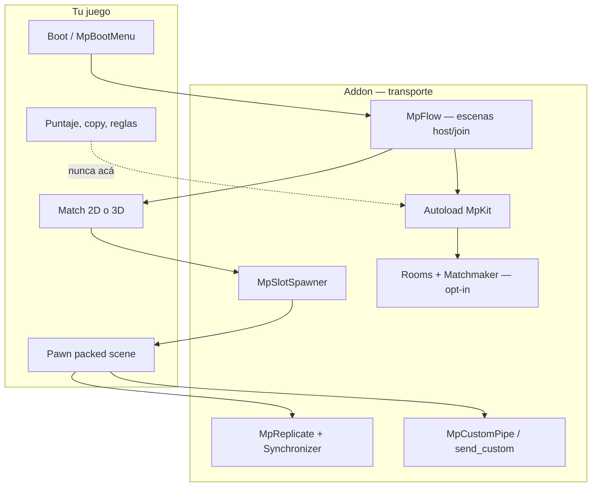

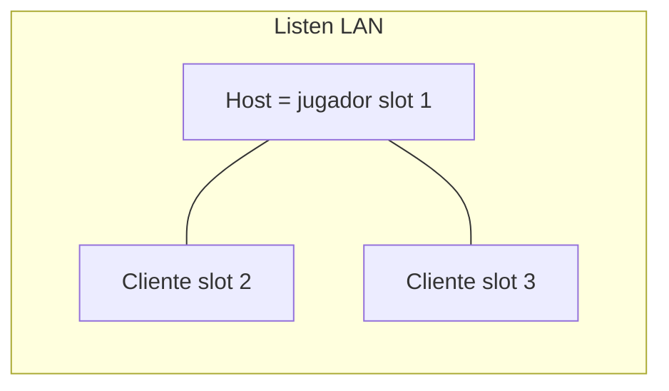

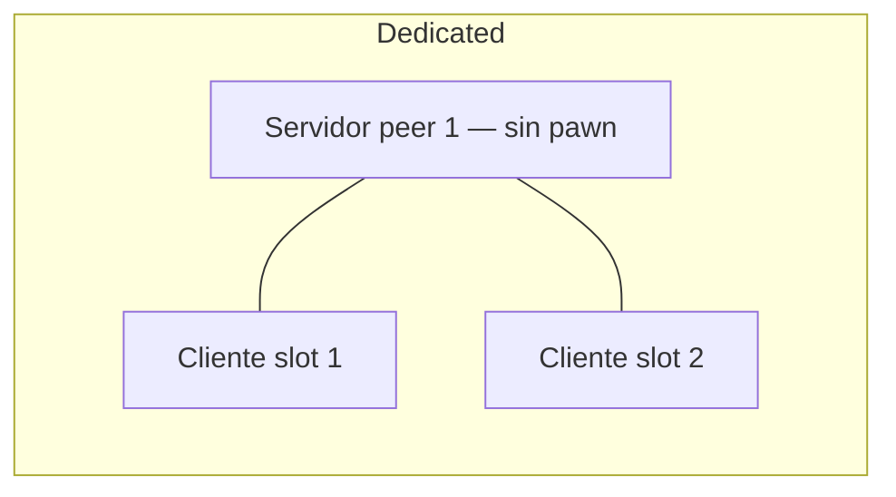

## Guía paso a paso (humano)

Hacé esto en Godot, en orden. Un mundo alcanza; varios mundos usan el catálogo al final del paso 3.

### 1. Plugin y autoload

1. Copiá `addons/mp_kit/` al proyecto.
2. Proyecto → Ajustes → Plugins → **MpKit** (Enable).
3. Proyecto → Ajustes → Autoload: tiene que existir `MpKit` apuntando a `res://addons/mp_kit/mp_kit.gd`.
4. Project → Tools → **MpKit: New session flow...**  
   O creá a mano un nodo `MpFlow`, guardalo como `res://glue/session_flow.tscn`, y agregalo de autoload **después** de MpKit.

En el inspector del flow:

| Propiedad | Qué poner |
|-----------|-----------|
| `boot_path` | `res://scenes/ui/boot.tscn` |
| `world_path` | tu match, si hay **un** mundo |
| `worlds` | lista de `MpWorldRef` si hay **varios** mapas (`id` + escena o path) |
| `max_players` | p.ej. 4 |
| `room_name` | nombre que verán en LAN |
| `advertise_lan` | on |
| `custom_channels` | p.ej. `emote` si vas a usar el túnel; vacío = todos |
| `start_when` | Listen: entra al hostear. Dedicated: **Dedicated first client** |

Varios mapas: en el lobby `select_world(&"2d")`. El joiner recibe `world_id` solo. Arg de proceso: `--world=3d`.

### 2. Escena de boot (lobby)

Opción A — drop-in: instancia `res://addons/mp_kit/mp_boot_menu.tscn`. Si ya hay `MpFlow`, el menú lo usa.

Opción B — a mano:

1. `Control` a pantalla completa. Botones: Jugar solo, Host LAN, Unirse + `LineEdit` de IP.
2. En el script:

```gdscript
func _on_play_solo() -> void:
	MpFlow.play_solo()

func _on_host() -> void:
	MpFlow.host_lan()

func _on_join() -> void:
	MpFlow.join_lan(%Ip.text)

func _ready() -> void:
	var beacon := MpLan.browse(self)
	beacon.rooms_changed.connect(_on_rooms)
```

3. Lista LAN: al elegir una fila, poné `address` en el LineEdit. Click Unirse. Esa lista es **LAN browse** (`MpLan.rooms_changed`), no las hub rooms de `MpKit.rooms`.
4. Dedicated: `MpFlow` hace `host_dedicated()` solo. El menú puede ocultarse si `MpBoot.is_dedicated_process()`.

### 3. Escena de match

Árbol típico:

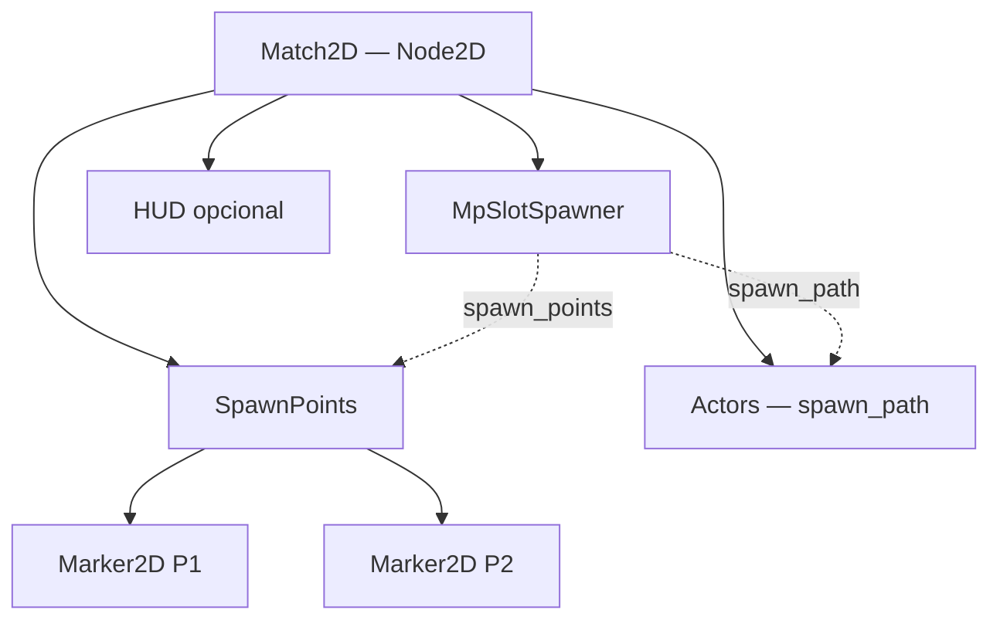

1. Raíz `Node2D` o `Node3D` (el mundo).
2. Hijo `Actors` (vacío). Ahí van los pawns replicados.
3. Hijo `SpawnPoints` con un `Marker2D`/`Marker3D` por slot (P1, P2, …).
4. **Crear nodo** → `MpSlotSpawner` (es un `MultiplayerSpawner`).
5. Inspector del spawner:

| Propiedad | Valor |
|-----------|--------|
| `spawn_path` | `../Actors` (el padre de los pawns) |
| `pawn_scene` | tu `pawn_2d.tscn` / `pawn_3d.tscn` |
| `spawn_points` | `../SpawnPoints` |
| `hold_until_world_ready` | **on** (default) |
| `gate_unsynced_spawns` | **on** (default) |
| `room_id` | vacío (un match por servidor); ver [Actores por sala](#actores-por-sala) |
| `despawn_on_leave` | on si querés borrar el pawn al irse |

No hace falta un nodo `MpWorldReady`. El spawner avisa solo que está listo en el cliente.

Dedicated **no** spawnea slot 0. Listen host spawnea su pawn en `_ready`. Los que se unen, en `client_world_ready`.

Handshake (no lo implementes: el kit ya lo hace):

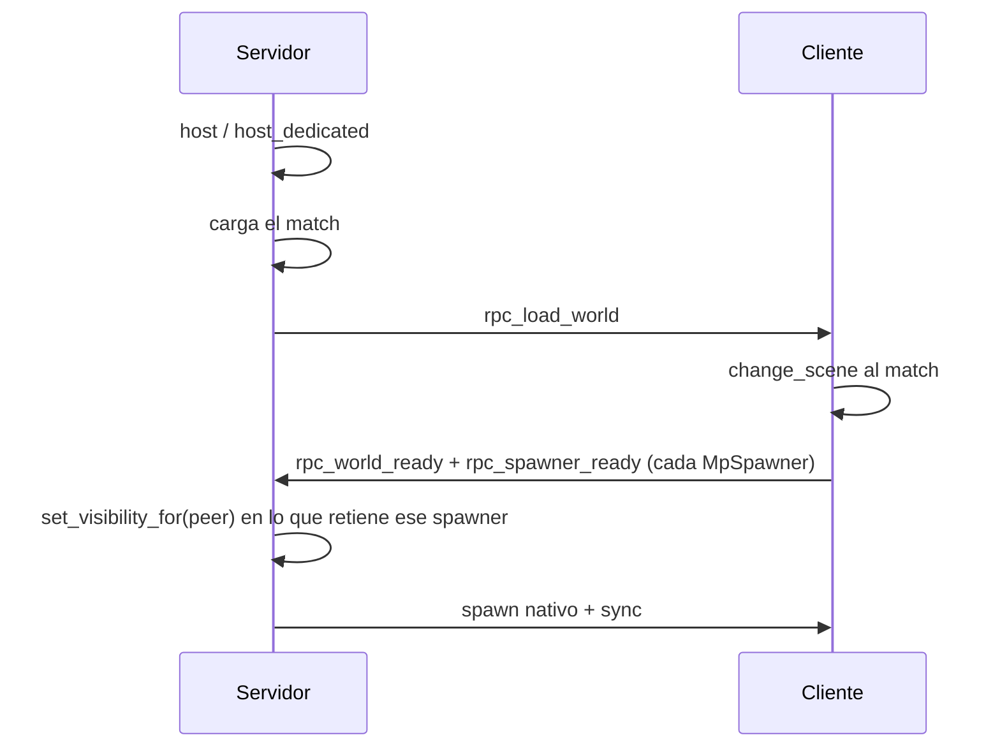

Qué retiene el spawner: los `MultiplayerSynchronizer` de la escena que le pertenecen, tanto los actores bajo `spawn_path` como los nodos estáticos del mundo (una puerta, un cofre). Un synchronizer le pertenece a los spawners cuyo padre es su ancestro más cercano con un hijo `MpSpawner` (una sala, un sub-mundo). Uno sin ese ancestro (un nodo estático al lado de un mundo instanciado) le pertenece a todos los `MpSpawner` de la escena. Nada le llega a un peer hasta que su copia del spawner existe, así que un peer en el lobby o todavía cargando nunca recibe un paquete de un nodo que no tiene (Godot no reintenta una ruta que falló: ese spawner o nodo quedaría muerto para ese peer).

Reglas:

- Todo mundo replicado necesita al menos un `MpSpawner` en la escena (un `MultiplayerSpawner` común solo sigue mandando a peers en el lobby). Los nodos estáticos con sync no necesitan nada más.
- Los synchronizers van en la escena, o se agregan por código **antes** del `add_child`, o en el `_ready` del propio actor. Uno agregado después (diferido, un timer) falta en el paquete de spawn: el que entra tarde recibe `ERR_INVALID_DATA` para ese actor. El spawner igual lo retiene y lo reporta con `push_error`.
- Un actor sin synchronizer recibe un synchronizer vacío `MpSpawnGate` en todos los peers al entrar a `spawn_path` (`gate_unsynced_spawns`). Sin él, Godot manda ese actor a todos los peers, lobby incluido, y la ruta fallida rompe el spawner para ellos. Apagalo solo si toda escena spawneada tiene synchronizer. En el servidor, un nodo que un script agrega a mano en `spawn_path` (un efecto solo del servidor, que el motor no replica) no recibe gate ni se retiene: el cliente nunca lo tiene. Se replica un nodo cuya escena está en la lista del spawner o que hizo `spawn(data)`; para eso asigná `spawn_function` en cualquier `_ready` de la escena (el del spawner, un hermano o el padre): el spawner la toma al final de ese frame. Si la asignás más tarde, avisa y la toma desde el nodo siguiente.
- Costo: en el servidor, un recorrido de la escena por cada revelado o cambio de asiento, y un chequeo de tipo por nodo que entra al árbol. Nada por frame.

### 4. Pawn (actor replicado)

1. Escena packed: `CharacterBody2D` o `CharacterBody3D`.
2. Collision + visual. `@export var player_slot: int = 1`.
3. Más simple: seleccioná la raíz → Project → Tools → **MpKit: Make selection a network actor** (agrega `MpActor` + `MpInput`; ver QUICKSTART). Con `MpReplicate` (camino de abajo) agregá a mano el hijo `MpReplicate` y un `MultiplayerSynchronizer`.  
   Eso agrega hijo `MpReplicate` + `MultiplayerSynchronizer` ya con posición / rotación / visible. El synchronizer tiene que vivir en la escena: `MpReplicate` no lo crea en runtime y, si falta, lo reporta con `push_error`.
4. En el dock **Replication** del synchronizer (o en el `.tscn`) agregá el resto:

| Path | spawn | replication |
|------|-------|-------------|
| `.:position` | sí | on change / always |
| `.:rotation` | sí | on change |
| `.:visible` | sí | on change |
| `.:player_slot` | **sí** | never (solo al nacer) |

5. Inspector de `MpReplicate`: `interpolate` on para proxies (el host no interpola).
6. Input **solo** si `player_slot == MpKit.local_slot()` (o un hijo de input que ya lo haga).
7. Comandos al servidor:

```gdscript
func try_move(dir: Vector2) -> void:
	if MpAuthority.should_send_command():
		submit_move.rpc_id(1, dir)
	else:
		apply_move(dir)

@rpc("any_peer", "call_remote", "reliable")
func submit_move(dir: Vector2) -> void:
	if not MpAuthority.accept_command(self, player_slot):
		return
	apply_move(dir)
```

Si el `submit_*` vive en un nodo que atiende a **todos** los jugadores (un nodo del match, no un pawn con `player_slot`), el slot sale del sender:

```gdscript
@rpc("any_peer", "call_remote", "reliable")
func submit_ready() -> void:
	var slot := MpAuthority.command_slot(self)
	if slot <= 0:
		return
	apply_ready(slot)
```

`command_slot(node)` devuelve el slot del peer que mandó el RPC, solo en el servidor. Da `0` fuera del servidor, sin red (1P) o si el peer no tiene slot. No uses `MpKit.slot_for_peer(multiplayer.get_remote_sender_id())` a mano en cada `submit_*`.

- `call_remote`: el host local **no** duplica el RPC.
- Dedicated nunca manda `submit_*` (no hay jugador local).
- Tipos de pawn/bala: Resource `.tres` en el actor, no un string `kind` por RPC.

Árbol del pawn:

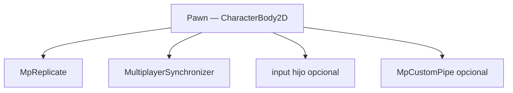

### 5. HUD y salir

Un botón Salir: `MpFlow.return_to_boot()`.  
HUD: `MpKit.local_slot()` (0 = proceso dedicated). Nunca `get_unique_id()` como id de jugador.

### 6. Probar

| Modo | Cómo |
|------|------|
| 1P | F5 → Jugar solo. Sin `create_server`. |
| LAN | Debug → Run Multiple Instances. A: Host LAN. B: sala de la lista o `127.0.0.1`. |
| Dedicated | CLI: `godot --headless --path . -- --dedicated`. Editor: instancia hub con etiqueta `dedicated_server` (marcá Anular argumentos si ponés `--headless -- --dedicated` en Argumentos de Inicio). Cliente Join `127.0.0.1`. |

## Túnel custom (Dictionary)

Sirve para datos **opacos** que no son transform del actor ni un `submit_*` de gameplay: emote, ping de UI, un handshake vuestro, debug.

El kit **no lee** el dict. **No reenvía solo**. Si el servidor no hace `broadcast_custom`, el resto de peers no se enteran.

### API

| Quién | Método | Qué pasa |
|-------|--------|----------|
| Cliente, 1P, o el propio servidor | `MpKit.send_custom(channel, data)` | Cliente → RPC al servidor. 1P / servidor: emite `custom_received` **en local** (`from_peer` 1 o tu unique id). |
| Solo servidor | `MpKit.broadcast_custom(channel, data)` | Emite en el servidor (`from_peer` = 1) **y** manda a todos los clientes. `broadcast_custom(channel, data, true)`: solo a los peers con el mundo cargado (`MpKit.ready_peers()`), para un efecto de un instante que un peer que todavía carga perdería. |
| Solo servidor | `MpKit.push_custom_to(peer_id, channel, data)` | Un cliente. El servidor **no** emite en local. |
| Todos | señal `MpKit.custom_received(channel, data, from_peer)` | Ahí recibís. |

Allowlist: `configure(..., PackedStringArray(["emote"]))`. Vacío = cualquier nombre. Nombre desconocido = se descarta.

Topes del servidor (para que un cliente no lo inunde): un mensaje del túnel de más de `MpKit.custom_max_bytes` (8192) se descarta, y cada cliente manda a lo sumo `MpKit.custom_limit` (30 por segundo, ráfaga de 60). Las llamadas `mp_sv_*` de `MpActor` tienen su propio tope (`MpActor.server_calls`: 60 por segundo, ráfaga de 120) y un máximo de argumentos de 4 KB. Con admisión por ticket, a lo sumo `MpKit.max_pending_admission` (64) conexiones esperan ticket a la vez.

Nodo cómodo: hijo `MpCustomPipe`, `@export channel = &"emote"`.

| Pipe | Equivale a |
|------|------------|
| `pipe.send(data)` | `MpKit.send_custom(channel, data)` |
| `pipe.broadcast(data)` | `MpKit.broadcast_custom` (no-op si no sos servidor) |
| `pipe.push_to(peer, data)` | `MpKit.push_custom_to` |
| señal `packet(data, from_peer)` | filtro de `custom_received` a ese canal |

### Mandar (cliente → servidor)

```gdscript
# En el pawn / feature (cliente o 1P)
$MpCustomPipe.send({"slot": player_slot, "msg": "hola"})
```

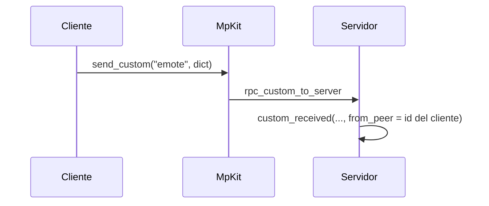

En 1P o si lo llama el listen host: no hay RPC; se emite ahí mismo. Por eso el host suele usar `broadcast` cuando quiere que **todos** lo vean (incluídos los clientes).

### Recibir

```gdscript
func _ready() -> void:
	MpKit.custom_received.connect(_on_custom)

func _on_custom(channel: StringName, data: Dictionary, from_peer: int) -> void:
	if channel != &"emote":
		return
	# from_peer == 1  → lo empujó el servidor (broadcast o send local)
	# from_peer == 2+ → llegó de ese cliente, todavía no está “en todos”
```

O en el actor: `$MpCustomPipe.packet.connect(_on_emote)`.

### Sincronizar al resto (el servidor reenvía)

Sin este paso, solo el servidor vio el paquete del cliente.

```gdscript
func _on_custom(channel: StringName, data: Dictionary, from_peer: int) -> void:
	if channel != &"emote":
		return
	if MpKit.is_server() and from_peer != 1:
		MpKit.broadcast_custom(channel, data)
```

`from_peer != 1` es obligatorio. `broadcast_custom` emite otra vez con `from_peer = 1`. Si reenviás también ese emit, el servidor se llama a sí mismo en bucle (el kit corta el re-entrante, pero igual duplicarías lógica).

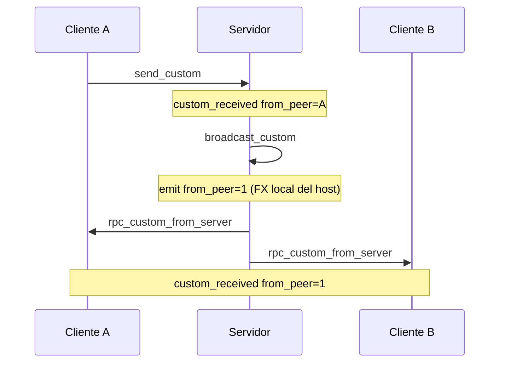

Un peer solo: `push_custom_to(peer_id, channel, data)` (el servidor no lo ve en local; si el host también debe reaccionar, `broadcast_custom` o un emit vuestro).

### Patrón en el actor (como el emote de la demo)

```gdscript
func try_emote() -> void:
	var data := {"slot": player_slot, "msg": "hola"}
	if not MpKit.is_networked() or not MpKit.is_server():
		$MpCustomPipe.send(data)      # 1P o cliente → servidor
		return
	$MpCustomPipe.broadcast(data)     # listen host: todos

func _on_emote_packet(data: Dictionary, from_peer: int) -> void:
	if int(data.get("slot", 0)) != player_slot:
		return
	if MpKit.is_networked() and MpKit.is_server() and from_peer != 1:
		return   # el servidor espera el broadcast (from_peer 1) para no flash 2 veces
	_flash()
```

El glue (autoload) sigue haciendo el reflect `from_peer != 1` → `broadcast_custom`. El actor no reenvía.

## Qué va por cada canal

| Dato | Dónde |
|------|--------|
| Posición, rotación, visible | `MultiplayerSynchronizer` (`MpReplicate`) |
| “Quiero mover / disparar” | `submit_*` en **tu** pawn + `accept_command` (nodo sin `player_slot`: `command_slot`) |
| Tipo de arma / look | Resource `.tres` en el actor, `spawn = true` si hace falta al nacer |
| Timer / score / vidas | Un match: `MpKit.push_snapshot`. Varias salas: `MpKit.rooms.push_snapshot_to_room` |
| Emote, ping, debug | Túnel custom. Varias salas: `push_custom_to_room`, no `broadcast_custom` |
| Cuándo empieza la partida | `MpFlow.start_when` / `start_match()`, o `match_assembled` si usás cola |

No metas meshes, puntaje ni `kind` de bala en el túnel.

## Menú Tools

Con el plugin enabled, **Project → Tools**:

- **Setup game...** — un juego multijugador completo desde un diálogo (`editor/mp_setup_wizard.gd`): `game.tres` (`MpGame`), boot con un `MpFlow` que solo tiene ese `.tres`, mundo con un `MpWorld`, jugador con `MpActor` predicho + `MpInput` y, opcional, salas online. Muestra el árbol de archivos (`[+]` / `[~]`) y nunca pisa uno existente. Prueba: el e2e `run_mpkit_wizard.sh` del laboratorio (genera un juego y lo juega en red; `WIZARD_3D=1` para 3D)
- **Make selection a network actor** — hijo `MpActor` (con su `MpSync`, que se arma y se guarda con la escena) y, si es un `CharacterBody`, `MpInput`
- **New replicated feature...** — `res://features/<id>/<id>.gd` + `.tscn`
- **New session flow...** — autoload `MpFlow` (`res://glue/session_flow.tscn`)
- **Install Cursor/VS Code snippets** — `.vscode/mpkit.code-snippets`

Al Enable copia plantillas a `res://script_templates/` (CharacterBody / Node2D / Node3D / Node).

## Piezas del addon

Nodos de alto nivel (lo que usa un humano; detalle y ejemplos en [QUICKSTART.md](QUICKSTART.md)):

| Archivo | Rol |
|---------|-----|
| `nodes/mp_actor.gd` | `MpActor`: hijo de lo que la red comparte. El servidor es su autoridad; la lista *Sync* arma en el editor un `MultiplayerSynchronizer` (`MpSync`) que se guarda en la escena; suaviza proxies; `owner_slot` (lo pone el spawner, viaja al nacer). `to_server(&"x", args)` corre `mp_sv_x(args)` en el servidor (solo el dueño puede pedirlo; `sender_slot()` dice quién); `to_all(&"x", args)` corre `mp_all_x(args)` en todos los peers que ya tienen el nodo (solo el servidor). `is_authority()`, `is_local()`, `MpActor.of(nodo)` |
| `nodes/mp_input.gd` | `MpInput`: junto a un `MpActor`. El dueño manda sus acciones del InputMap (frames con secuencia, contadores de pulsación que no se pierden con un paquete); en el servidor se leen con la API de `Input` (`get_vector`, `is_action_just_pressed`...). `set_value` / `get_value` para valores propios (mira, cursor) |
| `nodes/mp_state.gd` | `MpState`: valores de partida (`set_value`, `add`, `get_value`, señal `changed`, `watch(key, cb)`: el valor actual y después cada cambio; `unwatch`). Lo escribe el servidor; lo reciben todos, también el que vuelve. `MpState.of(nodo)` |
| `core/mp_sync_builder.gd` | lista del inspector → `SceneReplicationConfig` (transformaciones, sello y ack ALWAYS, el resto ON_CHANGE, `owner_slot` solo al nacer) |
| `core/mp_actor_sync.gd` | qué manda el synchronizer de un `MpActor` en cada modo: con suavizado o predicción la pose viaja en `MpActor.net_position` / `net_rotation` + `net_stamp`, nunca en la del nodo, así en el cliente solo `MpActor` mueve el nodo |
| `core/mp_input_frame.gd` | el input de un tick; contadores de pulsación; fuerzas en los pasos de 1/255 con que viajan |
| `core/mp_input_packet.gd` | `MpInputPacket`: una tira de frames en un paquete, codificada en delta (un frame que mantiene sus teclas ocupa 5 bytes), y los controles que un cliente hostil no pasa |
| `core/mp_input_queue.gd` | servidor con predicción: frames del dueño en orden, cada uno una vez, uno por tick; un frame tardío se supone (el último otra vez) y se descarta cuando llega; buffer de jitter (`depth`) que el dueño mantiene lleno con su ritmo; presupuesto (un cliente no puede ir más rápido mandando frames de más) |
| `core/mp_correction_smoother.gd` | `MpCorrectionSmoother`: la corrección del dueño dibujada desvaneciéndose (solo la pose visible; la real vuelve antes de cada frame de física) |
| `core/mp_prediction.gd` | predicción del dueño y reconciliación: el servidor corre `mp_move` por cada frame del dueño; el dueño vuelve al estado del servidor y repite los frames sin ack, dentro del tick de física |
| `core/mp_proxy_motion.gd` / `mp_interpolator.gd` | dibujo de proxies: `BUFFERED` (en el pasado, entre dos estados reales) o `FOLLOW` |
| `core/mp_net_clock.gd` | tiempo de simulación del servidor (ticks / tps, parejo) y su estimación en el cliente (sigue al paquete menos demorado) |
| `core/mp_lag_peer.gd` | red mala a propósito para probar: `--net-lag-ms`, `--net-jitter-ms`, `--net-loss` envuelven el peer (ENet o WS). Solo pruebas |
| `mp.gd` | `Mp`: los verbos de la partida desde cualquier script (`play_solo`, `host`, `join`, `leave`, `open_rooms`, `is_server`, `is_online`, `me`, `player`, `state`, `current_match`, `finish`, `net_quality`); llama a los nodos que hacen el trabajo |
| `mp_game.gd` | `MpGame` (`.tres`): un `MpNetConfig` con las escenas del juego; en `MpFlow.game` llena `net_config` y cada ruta vacía |
| `nodes/mp_start_button.gd` | `MpStartButton`: en el HUD; en un listen host cuya partida espera asientos arranca con los jugadores que ya cargaron (`Mp.gate().start_now()`) y muestra `cargados/esperados`; oculto en otro caso |
| `nodes/mp_waiting_label.gd` | `MpWaitingLabel`: en el HUD; mientras la partida espera sus asientos muestra `cargados/esperados` en todos los peers (los conteos de la puerta, válidos en el cliente); oculto en otro caso |
| `nodes/mp_local_seat.gd` | `MpLocalSeat`: quién mira esta pantalla; `slot`, `is_mine(slot)`, `is_online()`, `changed(slot)`, `preview_slot` (en solo: mostrar la partida como otro asiento), `MpLocalSeat.of(node)` por grupo. HUD, audio, órdenes y resultado lo reciben por `@export` |
| `nodes/mp_invite_label.gd` | `MpInviteLabel`: en el HUD; en una partida privada de esta PC (`MpLocalServer`) muestra lo que escriben los amigos (`ip:puerto#CÓDIGO`); oculto en otro caso. Lo busca por grupo, sin cargar los scripts de salas |
| `nodes/mp_world.gd` | `MpWorld`: un nodo en el mundo; en el editor arma `SpawnPoints`, `Actors`, `Players` (`MpSlotSpawner`), `State` (`MpState`), `Match` (`MpMatch`) y `Hud/Leave` + `Hud/Invite` + `Hud/Start` + `Hud/Waiting`; `player_scene` es la escena de cada asiento |
| `core/mp_net_quality.gd` | `MpNetQuality` (hijo del autoload, `MpKit.net_quality`): pings 4 por segundo; RTT (mediana), jitter (percentil 97), pérdida y nota `GOOD` / `FAIR` / `BAD`; el servidor guarda la de cada jugador. `Mp.net_quality()` |
| `core/mp_lag_comp.gd` | `MpLagComp`: compensación de lag en el servidor; un segundo de poses por actor (`MpActor.lag_compensate`), `position_at`, `rewind(stamp, callable)`; el momento que veía cada jugador viaja en `MpInputFrame.view` y en `to_server`; `--lag-comp=off` la apaga |
| `core/mp_net_config.gd` | `MpNetConfig` (`.tres`): la red del juego en un lugar; `apply()` configura `MpKit`; en web usa WebSocket (o el relay) y `can_host()` es falso |
| `nodes/mp_match.gd` | `MpMatch`: inicio y fin de una partida en el mundo; reemite lo que dice la puerta (arranque, ausencias, vueltas, abandonos), `finish(result)` escribe el resultado para la sala |
| `mp_match_gate.gd` | `MpMatchGate` (`/root/MpKit/Gate`, `Mp.gate()`): la puerta de arranque. Fases `IDLE`/`FILLING`/`RUNNING`; admite o rechaza con motivo (`match_started`, `full`, `grace_over`, `slot_taken`, `rejected`); credencial por asiento en modo abierto, identidad por ticket en salas; cuenta los cargados, pausa y despausa (también a los clientes), `rejoin_grace_s`, `load_timeout_s`, `late_join`, `give_up`, `displaced_by` (una credencial que vuelve tras una caída gana sobre la conexión vieja); con `wait_host` espera también el mundo del servidor (`mark_host_loaded`, y en solo `arm([], 0)`); con `loaded_on_world_ready` apagado un asiento cuenta al `report_loaded` y no al `world_ready`. Señales `waiting_changed`, `seat_admitted`, `seat_loaded`, `started`, `seat_away`, `seat_abandoned`, `all_gone`, `turned_away` |
| `rooms/mp_room_server.gd` | `MpRoomServer`: la escena del servidor de salas (lobby + `MpMatchLauncher` + reglas); `net_config` = el `MpNetConfig` del juego (vacío = el del flow, su `MpGame`); `match_scene` vacío = el `boot_scene` del `MpGame`; flags de `MpLobbyConfig`, `--lobby-config=`, `--match-args=`, `--match-engine-args=` y `--keep-match-files` |
| `rooms/mp_room_rules.gd` | `MpRoomRules`: reglas de sala pisando funciones (`seats_for`, `accept_options`, `accept_pick`, `accept_bot`, `build_ticket`) |
| `rooms/mp_local_server.gd` | `MpLocalServer`: un dedicado en la PC del jugador con códigos por asiento (`start_on(tree, seats)`, `server_ready(address, port, codes)`, `invites()`); se une con `ip:puerto#CÓDIGO` (`MpFlow.join_address`). Uno por proceso (un segundo `start_on` devuelve el que corre), con su carpeta de partidas por proceso |
| `deploy/` | `deploy.sh usuario@vps build` (un comando: usuario, archivos, unidades systemd, instancias, firewall), `mp-rooms@.service` / `mp-dedicated@.service` (una instancia por puerto), presets de export de ejemplo y la guía |
| `rooms/mp_lobby_link.gd` | el stack `/root/MpLobby` (autoload o creado al vuelo) |
| `rooms/ui/mp_lobby_screen.gd` / `mp_lobby_ui.gd` / `.tscn` | `MpLobbyScreen`: lobby drop-in (conectar, salas, crear, código, asientos, listo, chat) que se une a la partida por `MpFlow.join_match` |
| `core/mp_address.gd` | `MpAddress`: lo que una persona escribe para llegar a un servidor (IP, nombre, `:puerto`, `#CÓDIGO`, URL), igual en el menú, el lobby y `MpFlow.join_address` |
| `core/mp_relay_peer.gd` | `MpRelayPeer`: el transporte `relay` (WebSocket a un relay de MpKit; el host se conecta hacia afuera, sin IP pública). Cada puerto es la sala `<relay_room>-<puerto>`; una sala con host vivo está ocupada (4009) y el lanzador prueba otro puerto |
| `relay/` | `server.mjs` + `lib/` (relay Node sobre la librería `ws`, para Railway, Render, Fly o un VPS), `package.json`, sus pruebas (`npm test`) y la guía |
| `nodes/mp_leave_button.gd` | `MpLeaveButton`: el botón Salir de un HUD (`MpFlow.leave_match()`: al lobby o al menú); anda con el mundo pausado |
| `core/mp_rate_limit.gd` | `MpRateLimit`: cubeta de tokens por peer (túnel y `mp_sv_*`) |
| `core/mp_calls.gd` | llamadas por nombre (`mp_sv_*`, `mp_all_*`) con chequeo de cantidad de argumentos |
| `core/mp_smoother.gd` | suavizado exponencial de `MpReplicate` |
| `editor/` | el asistente Setup game (`mp_setup_wizard.gd`, `mp_setup_templates.gd`, `mp_setup_dialog.gd`) |
| `tests/` | tests propios del kit: `godot --headless --path <proyecto> --script res://addons/mp_kit/tests/mp_test_runner.gd` |
| `examples/arena_2d/` | ejemplo mínimo (boot, arena, jugador, lobby, servidor de salas); sirve de quickstart y de prueba e2e |

Helpers de rol en `MpKit`: `is_authority()` (solo o servidor: donde corren las reglas), `has_local_slot()` (hay un jugador en esta máquina con slot conocido). `local_slot()` devuelve 0 en un cliente hasta que el servidor le asigna slot (antes adivinaba). `MpSpawner.spawn_actor(escena, props, owner_slot)` instancia en el servidor bajo `spawn_path` (la escena tiene que estar en la lista del spawner). `MpFlow` se puede poner como nodo en la escena de boot: se muda solo a la raíz.

Piezas de bajo nivel:

| Archivo | Rol |
|---------|-----|
| `mp_transport.gd` | `MpTransport`: arma el peer ENet (UDP) o WebSocket (TCP) segun `--transport=enet\|ws`; `create_server`, `create_client`, `port_is_free` |
| `mp_kit.gd` | ENet o WebSocket (`MpKit.transport`) + slots + RPCs de sesión + túnel Dictionary. Hijos `Rooms` / `Matchmaker`. |
| `mp_ids.gd` | slot ↔ peer |
| `mp_room_directory.gd` | hub rooms (opt-in); asiento de sala ≠ slot del hub |
| `mp_matchmaker.gd` | cola FIFO; arma una room al llenar `party_size` |
| `mp_boot.gd` | detectar proceso dedicated, flags de la línea de comandos, asientos del ticket (`ticket_seats`) |
| `mp_flow.gd` | escenas, host/join/1P, catálogo de mundos |
| `mp_world_loader.gd` | `MpWorldLoader`: único dueño de la carga del mundo (hilo, progreso, «el mundo avisa que está listo», lectura en el hilo principal si el hilo falla); hijo interno del `MpFlow` |
| `mp_world_ref.gd` | un mundo del catálogo |
| `mp_replicate.gd` | authority + freeze + lerp de proxy (el synchronizer vive en la escena) |
| `mp_spawner.gd` | MultiplayerSpawner + hold por peer de su alcance + `room_id`; `spawn_actor(scene, props, owner_slot)`, `spawn_here(data)` (spawnea en el servidor o en solo, `null` en un cliente) |
| `mp_slot_spawner.gd` | un pawn packed por slot ocupado: en `client_world_ready`, y en `_ready` para los peers que ya tenían el mundo listo |
| `mp_boot_menu.gd` / `.tscn` | lobby drop-in |
| `mp_custom_pipe.gd` | un canal del túnel |
| `mp_lan.gd` / `mp_lan_beacon.gd` | IPv4 + UDP advertise/browse |
| `mp_authority.gd` | `accept_command`, `command_slot`, `accept_room_command`, freeze, sync |
| `mp_world_ready.gd` | legado (no-op si hay `MpSpawner`) |
| `lobby/mp_lobby_config.gd` | `MpLobbyConfig` (`.tres`): límites y tiempos del servidor de salas; cada campo numérico se pisa con `--nombre-con-guiones=N` (`with_cli_overrides()`). `max_matches` por defecto 99 |
| `lobby/mp_match_launcher.gd` | `MpMatchLauncher`: un dedicado por partida (`launch(id, ticket)`, puerto libre del rango, tope `ERR_BUSY`, registro de pids, mata latido viejo / huérfanos). Señales `match_listening`, `match_ended`, `match_failed` |
| `lobby/mp_match_agent.gd` | `MpMatchAgent` (en el dedicado): lee `--match-ticket-file` y `--room-pid`, nombra el asiento de cada token (`seat_of`: sha256 y vencimiento) y arma la puerta con él (`arm_gate`), escribe `state.json` (latido) y `result.json` (`report_result(data)`), sale si muere el padre |
| `lobby/mp_process_runner.gd` / `_stub.gd` | (pids e identidad por `ps`: validado en macOS y Linux; en Windows, mejor esfuerzo) `OS.create_process` / `is_process_running` / `kill`; el stub simula procesos sin Godot |
| `lobby/mp_lobby_rooms.gd` | `MpLobbyRooms` (RefCounted, sin red): estados de sala `OPEN`/`COUNTDOWN`/`LAUNCHING`/`IN_MATCH`/`CLOSED`, asientos por `session_id` (`resume_grace_s`), pick opaco validado por Callable, cuenta regresiva con `tick(delta)`, lanza con `MpMatchLauncher`. Los comandos devuelven un código String ("" = ok); señales `room_changed`, `match_assigned`, `room_error`, `room_closed`. Asientos por sala: `seat_count_for(options)` (tope `max_seats_per_room`); el que crea es el anfitrión y pasa al siguiente sentado si se va; el anfitrión llena asientos libres con bots (`set_seat_bot` / `clear_seat_bot`, `bot_validator`): un bot ocupa el asiento, está siempre listo y en el ticket es una fila `{slot, bot: true, meta}` sin token, que el agente nunca admite |
| `lobby/mp_lobby_server.gd` | `MpLobbyServer`: pone `MpLobbyRooms` en ENet o WebSocket (`lobby_port`, `MpLobbyConfig.transport`). Valida versión, nombre, tamaño de `options`/`meta`, ritmo de chat y `hello_timeout_s`; el cliente no elige slot, puerto ni semilla. `meta_validator`, `options_validator`, `ticket_builder`, `seat_count_for` y `bot_validator` los pone el juego antes de `start(config, launcher)`. Protocolo `proto_version` 2. Códigos de error estables (`version`, `bad_name`, `rate`, `bad_options`, `bad_meta`, `bad_bot`, `not_host` y los de `MpLobbyRooms`) |
| `lobby/mp_lobby_client.gd` | `MpLobbyClient`: espejo (`rooms`, `room`, `chat_log`), comandos (`create_room`, `join_room`, `join_code`, `leave_room`, `choose_seat`, `set_pick`, `set_ready`, `send_chat`, `refresh_rooms`, `resume`) y señales en pasado (`room_updated`, `countdown_started`, `match_ready(host, port, token)`, `match_finished(result)`, `error_received`...). `host` vacío en `match_ready` = el del lobby (`MpLobbyConfig.public_host`). `auto_resume` (apagado por defecto, con `resume_window_s` = 120 y `resume_retry_s` = 2): si el enlace cae, el cliente reintenta con su ficha y no emite `lobby_lost` hasta agotar la ventana (`lobby_resuming(attempt)` en el medio, `lobby_lost("resume_window")` al final); la ventana debe coincidir con `MpLobbyConfig.resume_grace_s` del servidor |
| `lobby/mp_lobby.gd` | Autoload `MpLobby` (después de `MpKit`): hijos `Server` y `Client` con un `SceneMultiplayer` propio; no toca el peer de `MpKit`. `MpLobby.start_server(config, launcher)` / `MpLobby.connect_to(host, port, nombre)`. Prueba: `agent/run_034d.sh` |
| `lobby/mp_match_files.gd` | rutas `user://mp_matches/<id>/{ticket,state,result}.json`, JSON atómico (0600), sha256 |

Handshake de spawn: `hold_until_world_ready` (synchronizers ocultos hasta que el spawner de ese peer avisa que está listo; Godot manda spawn + sync emparejados). Dedicated: no pawn para peer 1. No desparentes actors en glue.

## Servidor de salas

**Camino de nodos (recomendado)**: `MpRoomServer` (escena del servidor) + `MpLobbyConfig` + `MpRoomRules` (opcional), `MpLobbyScreen` en el cliente y `MpMatch` en el mundo. Ver [QUICKSTART.md](QUICKSTART.md) › Online. Prueba sin juego: el e2e `run_mpkit_rooms.sh` del laboratorio (`TRANSPORT=ws` para WebSocket). Lo que sigue es la referencia de las piezas de abajo, que esos nodos envuelven sin cambiarlas.

Regla de dependencias: `MpFlow` y los nodos del mundo (`MpMatch`) nunca nombran clases del lobby (`MpMatchAgent`...): las buscan por grupo o las cargan por ruta. Un juego que carga el lobby como autoload y referencia su flow desde el glue del dedicado formaría un ciclo de carga.

Camino de internet: un **servidor de salas** (lobby, un proceso) y **un dedicado por partida** (otro proceso Godot que el servidor lanza). Los clientes no escriben la IP de la partida: hablan con el lobby y reciben `(host, port, token)` cuando arranca. Todo vive en `lobby/` y no sabe nada del juego: reglas, textos y resultados entran por `Callable` y `Dictionary` que pone el pegamento.

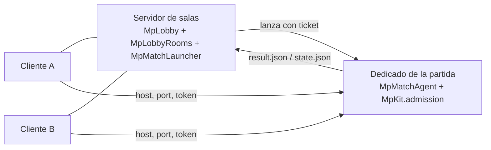

### Piezas

| Pieza | Para qué |
|-------|----------|
| `MpLobbyConfig` (`.tres`) | Límites y tiempos (puerto, tope de salas y partidas, rango de puertos, TTL del ticket, gracias de reconexión). Cada campo numérico se pisa con `--nombre-con-guiones=N`. |
| `MpLobby` (autoload, después de `MpKit`) | Contenedor con `Server` y `Client`, con su propio `SceneMultiplayer`: el enlace al lobby nunca toca el peer de `MpKit`. |
| `MpLobbyRooms` | Estado de salas sin red: `OPEN`, `COUNTDOWN`, `LAUNCHING`, `IN_MATCH`, `CLOSED`; asientos por sesión, pick opaco, cuenta regresiva. |
| `MpLobbyServer` / `MpLobbyClient` | Protocolo del lobby. El cliente nunca elige slot, puerto ni semilla. El cliente es un espejo (`rooms`, `room`) con señales en pasado. |
| `MpMatchLauncher` | Un dedicado por partida (ver abajo). |
| `MpMatchAgent` | Lado del dedicado: lee el ticket, arma `MpKit.admission`, escribe latido y resultado. |

### Admisión y tickets

1. Al terminar la cuenta regresiva, el servidor llama al `ticket_builder` del juego (`seats`, `options` → `Dictionary`) y le pasa el resultado al launcher.
2. El launcher agrega `match_id`, `port`, `room_pid`, `expires_ms` y, por asiento, cambia el `token` por su `token_sha256`. Escribe `user://mp_matches/<id>/ticket.json` (0600). El token en claro solo viaja al cliente de ese asiento.
3. El dedicado se lanza con `--match-ticket-file`. `MpMatchAgent` compara `sha256(token presentado)` contra el ticket y fija `MpKit.admission`: un ticket de otra sala, inventado, vencido (`ticket_ttl_s`) o ya conectado se rechaza. Sin ticket a tiempo: `timeout`.
4. Los clientes se conectan con `MpKit.join(host, port, token)` / `MpFlow.join_endpoint(...)`. Un `host` vacío en `match_ready` significa «el mismo del lobby» (o `MpLobbyConfig.public_host`).

El juego inyecta, sin tocar el kit: `meta_validator` (pick de cada asiento), `options_validator` (opciones de la sala) y `ticket_builder`. Los textos de error son códigos estables (`version`, `bad_name`, `bad_options`, `rate`...); la UI los traduce.

### `MpMatchLauncher`

- `launch(id, ticket)`: elige un puerto libre del rango (`match_port_min`..`match_port_max`, probado con `MpTransport.port_is_free`), escribe el ticket y crea el proceso. Tope `max_matches`: devuelve `ERR_BUSY`.
- Sigue `state.json` (latido cada `heartbeat_s`) y `result.json`. Mata la partida sin latido (`heartbeat_stale_s`), la que pasa de `match_max_s` y las que dejó una corrida anterior (`reap_on_ready`, con registro de pids y chequeo de identidad por `ps`).
- Señales: `match_listening`, `match_ended(id, result)`, `match_failed(id, reason)`.
- `executable`, `base_args` y `agent_args` los pone el juego (`--headless --path <dir> <escena> -- --dedicated`...). `agent_fields` del config son las cifras que el servidor reenvía al dedicado como `--campo=valor` (incluye `transport`).
- `keep_files` conserva la carpeta de la partida (solo pruebas); por defecto se borra al terminar.
- El dedicado sale solo si muere el servidor (`--room-pid`), si no queda nadie (`idle_no_players_s`) o `result_quit_delay_s` después del resultado.

### Transportes: ENet y WebSocket

Un solo valor: `MpLobbyConfig.transport` o `--transport=enet|ws`. El servidor lo usa para el lobby y se lo reenvía a cada dedicado. ENet (UDP) es el defecto; WebSocket (TCP) sirve para web y para túneles TCP. Mismo transporte en cliente, servidor y dedicados. Detalle en [Transporte](#transporte-enet-udp-o-websocket-tcp).

### Reconexión y retomar

- **Lobby**: la sesión tiene un token. Si el enlace cae, el servidor guarda el asiento `resume_grace_s`. `MpLobbyClient.resume()` vuelve con el mismo token (misma sesión y asiento). Con `auto_resume = true` el cliente reintenta solo cada `resume_retry_s` durante `resume_window_s` (igualala a `resume_grace_s`) y emite `lobby_resuming(attempt)`; `lobby_lost("resume_window")` solo al agotarse.
- **Partida**: un jugador que se cayó vuelve al mismo dedicado con **el mismo ticket** dentro de `rejoin_grace_s` y recupera su slot (el juego decide qué conserva, p.ej. su pawn). Pasada la gracia, el asiento cuenta como abandono y el juego decide el resultado. Si el servidor todavía no notó la caída, gana el ticket: se suelta la conexión vieja y el asiento vuelve como rejoin. Lo decide la puerta de arranque (abajo), igual que en LAN.
- `load_timeout_s`: cuánto espera el dedicado a que cada asiento cargue el mundo; qué significa no cargar lo decide el juego.

### Puerta de arranque (`MpMatchGate`)

Un solo dueño decide quién se sienta y cuándo arranca la partida, en todos los caminos: Host LAN, dedicado a mano, dedicado de sala y el menú sin flow (`MpBootMenu` con `drive_kit`). Por defecto no hay *late join*: el que llega después del arranque se rechaza con `match_started`; solo vuelve (*rejoin*) un asiento que se fue, dentro de `rejoin_grace_s`. `late_join` (`MpFlow` / `MpBootMenu`, `--late-join`) deja abiertos los asientos libres después del arranque, en LAN y en un dedicado a mano. Un dedicado a mano sirve una partida tras otra: cuando su partida termina y se va el último jugador, o todos pasaron la gracia (`all_gone`), carga un mundo nuevo y vuelve a armar la puerta (`MpFlow.next_open_match()`).

| Fase | Quién entra | El mundo |
|---|---|---|
| `IDLE` | nadie la armó: solo, o un servidor sin flow (modo de siempre, `admission` si la hay) | corre |
| `FILLING` | el primer asiento libre (LAN: credencial nueva) o el que nombra el ticket; un asiento que se cae conserva su credencial durante la gracia | pausado en todos los peers (`pause_clients`) hasta que cargan los que espera (`start_seats`, 0 = todos los asientos; `--start-seats=N`), pasa `load_timeout_s` (15 s), o el host LAN toca Start now (`MpStartButton`) |
| `RUNNING` | un asiento ausente dentro de la gracia (su credencial o ticket gana sobre una conexión vieja); con `late_join`, también un asiento libre; los demás: `match_started` / `grace_over` / `slot_taken` / `full` | corre |

El cliente **siempre** se presenta al conectar (`rpc_present_ticket`): su ticket, la credencial que ese `host:puerto` le dio antes (en memoria, sobrevive a `leave()`; `forget_seat_credentials()` la borra) o `""`. Un servidor sin puerta ni `admission` lo ignora. Cambio de protocolo: un build viejo y uno nuevo no se entienden (subí la versión en los dos).

### Probar y desplegar

- Local, headless y sin ventanas: `agent/run_034d.sh` (protocolo, con el runner stub), `run_034e.sh` (dos salas 1v1 en paralelo con dos dedicados reales), `run_034g.sh` (reconexión), `run_034_soak.sh [N]` (N corridas seguidas con ENet y WS, más chequeo de procesos huérfanos). `TRANSPORT=ws` en el entorno cambia el transporte.
- Servidor de salas con un runner de procesos propio: `MpProcessRunner` (`OS.create_process`, `is_process_running`, `kill`); `MpProcessRunnerStub` simula procesos para pruebas sin Godot.
- Despliegue en un VPS Linux: [deploy/README.md](deploy/README.md) (`deploy.sh`, unidades plantilla, varias instancias). `MpFlow.room_server_path` hace que `--room-server` abra la escena del servidor de salas.
- Para `wss://` (TLS) mirá la sección de transporte.

## Salas hub y cola (opcional)

Sirve cuando **un** `host_dedicated()` tiene que correr **varias partidas a la vez** en el mismo proceso (cola 1v1, 2v2, código para un amigo).

Si tu juego es un match por servidor, **no toques esto**. El `example/` no usa cola ni `create_room`.

No es la lista LAN del boot. Esa es `MpLan.browse` → `rooms_changed` (nombre + IP de un listen host). Las hub rooms viven en `MpKit.rooms`.

El kit **agrupa peers**. No cambia de escena, no instancia N mundos y no pone puntaje. Eso es glue.

### Qué aparece solo

Al arrancar, `MpKit` crea dos hijos. No hace falta agregar nodos a mano.

```
/root/MpKit
├── Rooms        # MpRoomDirectory — asientos + código. Tiene RPC
└── Matchmaker   # MpMatchmaker    — cola FIFO. Sin RPC
```

`MpKit.leave()` vacía directorio y cola; **no** borra estos nodos.

### Cuatro IDs distintos (no los mezcles)

| Nombre | Qué es | Ejemplo |
|--------|--------|---------|
| ENet `peer_id` | Ruteo de RPC | `2`, `3`, `4` |
| Hub **slot** (`local_slot()`) | Conexión a este proceso. Dedicated: clientes `1..max_players` | slot 3 |
| Room **id** + **seat** | Sala y asiento **dentro de esa sala** | `r_1`, seat `0` o `1` |
| Room **code** | Para unirse a mano (mayúsculas, sin `0 O 1 I`) | `K7P2` |

El HUD de “sos el jugador 1 de esta partida” usa el **seat**, no `local_slot()`.

`max_players` es el cupo de **conexiones al hub**, no el tamaño de una partida. 16 salas de 2 = `configure(..., 32)`.

### Inspector (Remote, en play)

Con el dedicated corriendo: Árbol remoto → `MpKit` → `Rooms` / `Matchmaker`.

| Nodo | Propiedad | Default | Para qué |
|------|-----------|---------|----------|
| `Rooms` | `max_rooms` | 16 | Tope de salas (las vacías también cuentan hasta `close_room`) |
| `Rooms` | `seats_per_room` | 2 | Asientos si `create_room()` no pasa tamaño |
| `Rooms` | `code_length` | 4 | Largo del código |
| `Matchmaker` | `party_size` | 2 | Cuántos saca la cola para armar una sala |

Desde glue, antes de encolar:

```gdscript
MpKit.rooms.max_rooms = 16
MpKit.rooms.seats_per_room = 2
MpKit.matchmaker.party_size = 2
```

### Camino A — cola automática

El servidor mete peers a la cola. Cuando hay `party_size`, el kit arma la sala **al toque** (sin botón Accept, sin nick, sin `change_scene`).

```gdscript
func _ready() -> void:
	super._ready()
	MpKit.peer_joined.connect(_on_peer_joined)
	MpKit.matchmaker.match_assembled.connect(_on_match)

func _on_peer_joined(peer_id: int, _slot: int) -> void:
	if not MpKit.is_server():
		return
	MpKit.matchmaker.enqueue(peer_id)

func _on_match(room_id: StringName, peer_ids: PackedInt32Array) -> void:
	# glue: spawn / lógica de ESA sala. peer_ids ya están sentados 0..n-1
	print(room_id, MpKit.rooms.code_for_room(room_id), peer_ids)
```

`enqueue` ignora si el peer ya está en cola o ya sentado. Si se desconecta, sale de la cola. Si `create_room` falla (tope de salas), **quedan en cola** y no hay `match_assembled`.

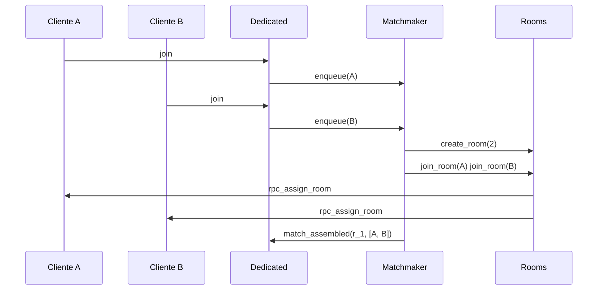

### Camino B — código privado

Sin cola. El servidor crea una sala vacía, le das el código a un amigo, el glue sienta a quien lo manda.

```gdscript
# servidor (host de la sala, o un operador)
var room_id := MpKit.rooms.create_room(2)
var code := MpKit.rooms.code_for_room(room_id)
# mostrá `code` en UI / copiá al clipboard — el kit no tiene pantalla

# cuando un cliente manda el código (túnel o submit_* vuestro):
func _seat_with_code(peer_id: int, code: String) -> void:
	if MpKit.rooms.join_room_by_code(peer_id, code) != OK:
		return
```

El cliente recibe `MpKit.rooms.room_assigned(room_id, seat)` (RPC). `create_room` **no** sienta a nadie.

Sala llena → señal `room_ready` en el servidor. `leave_room` libera el asiento y **no** cierra la sala. `close_room` saca a todos y borra (así deja de contar en `max_rooms`).

### Sincronizar datos solo a esa sala

`push_snapshot` / `broadcast_custom` llegan a **todo el hub**. Con varias partidas eso cruza datos. Usá:

```gdscript
MpKit.rooms.push_snapshot_to_room(room_id, {"elapsed": t})
MpKit.rooms.push_custom_to_room(room_id, &"emote", data)
```

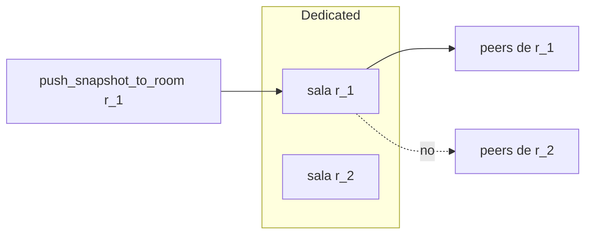

### Actores por sala

Varias partidas en una misma escena de mundo: cada sala tiene su subárbol con su propio spawner, y en el servidor se le pone `room_id` cuando la sala existe.

```
Hub (escena de mundo)
├── Room_r_1
│   ├── Actors
│   └── MpSpawner   # room_id = r_1, spawn_path = ../Actors
└── Room_r_2
    ├── Actors
    └── MpSpawner   # room_id = r_2
```

```gdscript
func _on_match(room_id: StringName, _peer_ids: PackedInt32Array) -> void:
	var room := ROOM_SCENE.instantiate()
	room.name = "Room_%s" % room_id
	room.get_node("MpSpawner").room_id = room_id
	add_child(room)
```

El servidor revela ese spawner solo a los peers sentados en `room_id` (lo chequea en `MpKit.rooms`, no le cree al cliente). Al levantarse se oculta de nuevo y Godot despawnea sus actores en ese cliente. Los clientes arman el mismo nodo `Room_<id>` (por ejemplo en `MpKit.rooms.room_assigned`); su spawner avisa que está listo al entrar al árbol. Los synchronizers de cada sala le pertenecen al spawner de la sala, así que un spawner del mundo sin `room_id` (en la raíz del hub) no los revela. No pongas dos spawners con distinto `room_id` bajo el mismo padre: comparten lo que retiene ese padre.

### Comandos de gameplay en una sala

El `submit_*` de un match único sigue con `accept_command(self, player_slot)` (slot del **hub**).

Si el pawn representa un asiento de sala:

```gdscript
@rpc("any_peer", "call_remote", "reliable")
func submit_move(dir: Vector2) -> void:
	if not MpAuthority.accept_room_command(self, room_id, seat):
		return
	apply_move(dir)
```

`accept_command` no se reemplaza: son dos chequeos distintos.

### Probar en local

1. Dedicated: `godot --headless --path . -- --dedicated` (`max_players` ≥ gente conectada).
2. Dos (o `party_size`) clientes Join `127.0.0.1`.
3. En el debugger del servidor: `MpKit.matchmaker.enqueue(MpKit.peer_id_for(1))` y lo mismo para el slot 2 → una `r_1`. Otro par → `r_2`.
4. Código: `create_room()` + `join_room_by_code` con un string de 4 chars.

### Qué no hacer

- Usar `local_slot()` como asiento de la partida.
- `push_snapshot` / `broadcast_custom` a todo el hub si hay más de una sala.
- Esperar que el kit abra un match scene por sala.
- Meter Steam o WebRTC en el addon. Cero puntaje / copy de título acá.

