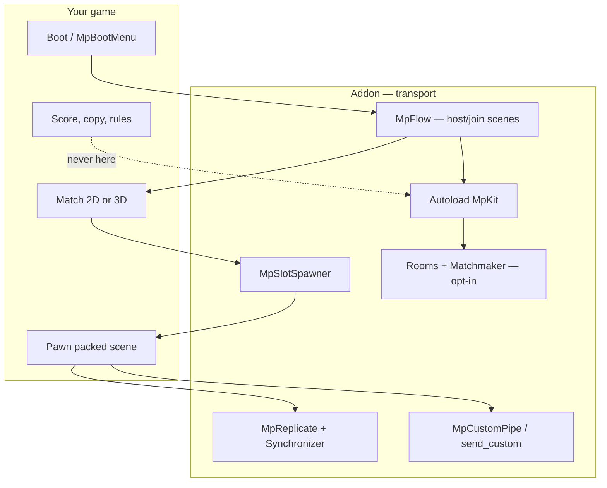
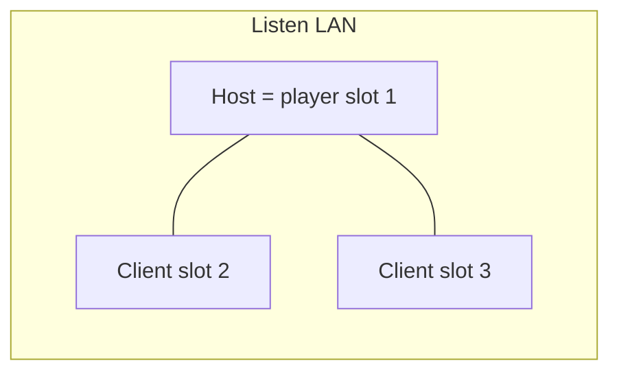
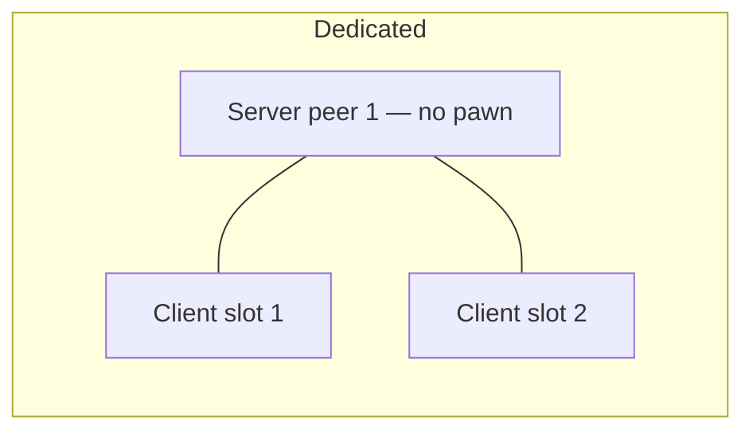
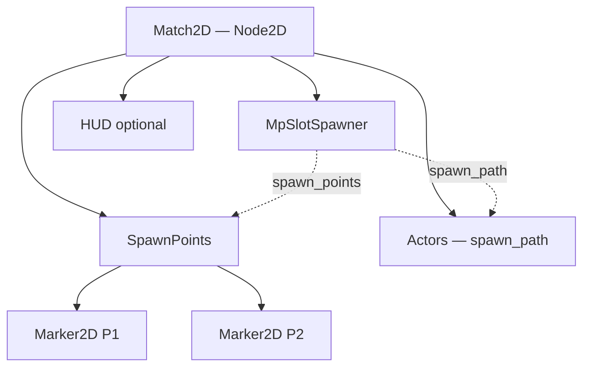
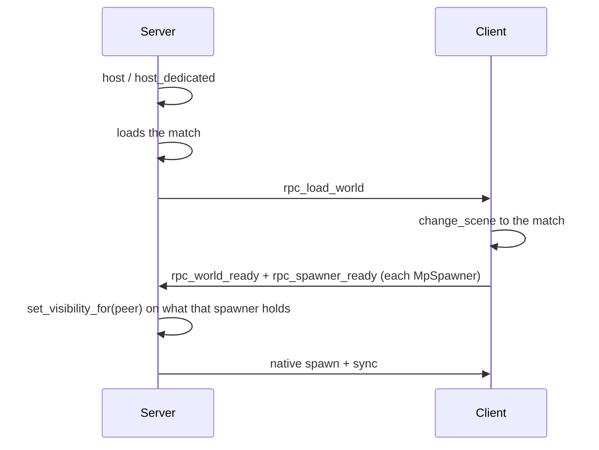
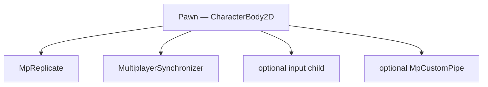
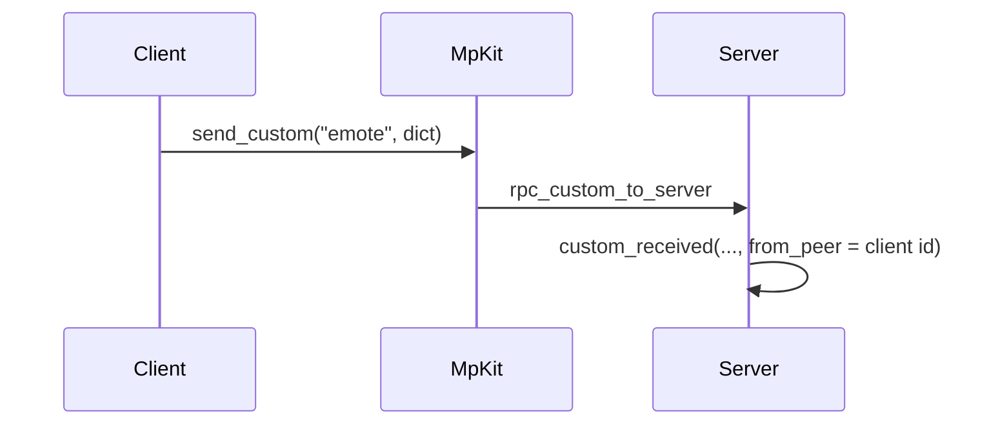
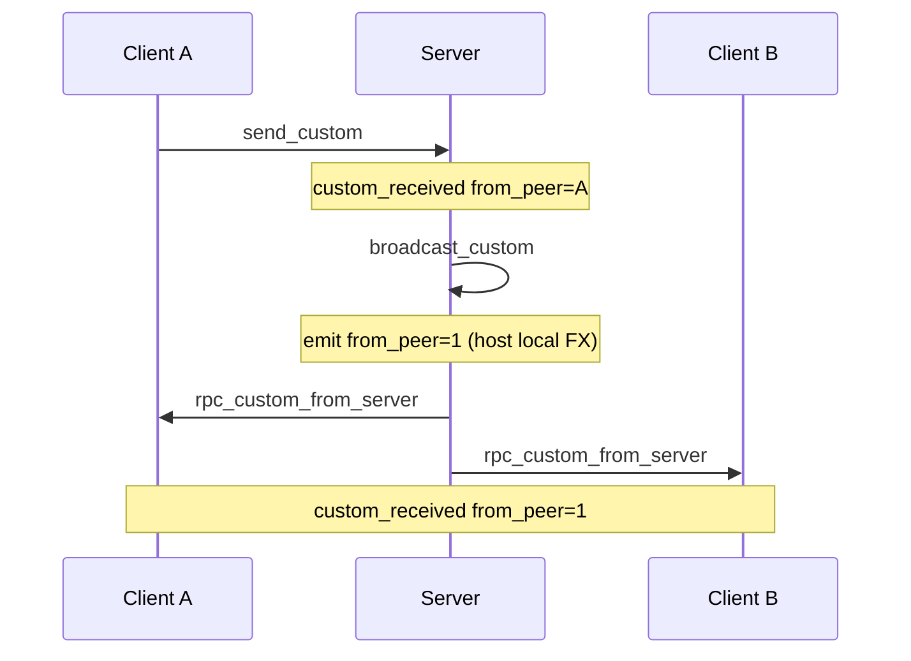
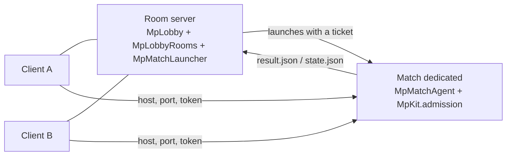
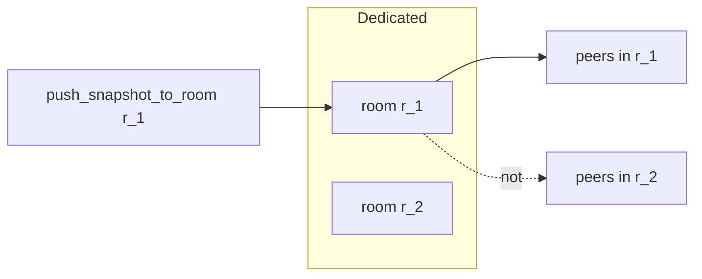

# MpKit — informal multiplayer kit (Godot 4)

Canonical copy: this repo (`addons/mp_kit`). Host-authoritative helpers. **No gameplay** in `mp_kit.gd`: no scores, copy, or pawns. `MpFlow` only changes boot/world scenes.

Do **not** install for a 1P-only game.

This guide is for **manual setup in the editor**. Code identifiers stay in English.

**First time?** Start with [QUICKSTART.md](QUICKSTART.md): six steps with the `MpActor`, `MpInput` and `MpState` nodes, no RPCs to write. The `examples/arena_2d/` example runs solo, on a LAN and on a dedicated server. What follows is the reference of every piece.

## Contents

1. [Install](#install)
2. [Two server modes](#two-server-modes)
3. [Mental map](#mental-map)
4. [Step-by-step (human)](#step-by-step-human)
5. [Custom Dictionary tunnel](#custom-dictionary-tunnel)
6. [What goes on each channel](#what-goes-on-each-channel)
7. [Tools menu](#tools-menu)
8. [Addon pieces](#addon-pieces)
9. [Room server](#room-server)
10. [Hub rooms and queue (optional)](#hub-rooms-and-queue-optional)

## Install

```bash
./install.sh --addon /path/to/godot-project
```

Or copy this folder to `res://addons/mp_kit/` and enable **MpKit** in Project → Project Settings → Plugins.

```
MpKit="*res://addons/mp_kit/mp_kit.gd"
```

The `MpKit` autoload goes **before** `MpFlow` (or your subclass). For CI/headless keep the line in `project.godot`; do not also Enable if that would duplicate it.

1. `MpKit.configure(port, max_players)` (`MpFlow` does this if you use it) **before** `host()` / `host_dedicated()` / `join()`.
2. Optional 4th argument: `PackedStringArray` of tunnel channel names (empty = all allowed).
3. **Do not** put game rules in `mp_kit.gd`.

Online = dedicated with a public IP and open UDP (or TCP with `--transport=ws`, see [Transport](#transport-enet-udp-or-websocket-tcp)). Locally: `godot --headless --path . -- --dedicated` and clients to `127.0.0.1`.

## Transport: ENet (UDP) or WebSocket (TCP)

The transport is selectable; the API, RPCs and replication are the same with both. `MpTransport` (`mp_transport.gd`) only builds the `MultiplayerPeer`.

| | ENet (default) | WebSocket |
|---|---|---|
| Value | `enet` | `ws` |
| Protocol | UDP | TCP (`WebSocketMultiplayerPeer`) |
| Web export | no (a browser cannot open UDP) | yes |
| TCP tunnel (ngrok, etc.) | no | yes |

- **One place**: an `MpGame` (`.tres`) in `MpFlow.game`: the network (it is an `MpNetConfig`: transport, port, players, `public_host`, relay, TLS) and the scenes (boot, world, lobby, rooms). The menu, the lobby screen and the room server read it from the flow. Flags win over it. A plain `MpNetConfig` in `MpFlow.net_config`, with the paths on the flow, still works.
- **Web**: a web export uses WebSocket (direct, or through the relay when the `.tres` says `relay`), never hosts nor browses LAN rooms (`MpNetConfig.can_host()`); the menu hides those rows. Check: `mpkit_lab/run/web.sh` (and `TRANSPORT=relay`), which opens the page in a headless Chrome.
- **Relay**: `--transport=relay` (or `transport = relay` in the `.tres`) with `relay_url` / `relay_room`: everything goes through a WebSocket tunnel ([relay/README.md](relay/README.md)); the server needs no public IP. It serves desktop and web.
- **Flag**: `--transport=ws` (or `enet`). Read by `MpKit` (`MpKit.transport`, before `host()`/`host_dedicated()`/`join()`; glue may set it by hand) and `MpLobbyClient.transport`.
- **Room server**: `MpLobbyConfig.transport` (`.tres` or `--transport=ws`). It serves the lobby with that transport, picks free match ports for TCP or UDP accordingly and **forwards it to the child dedicated** (`transport` is in `agent_fields`, it arrives as `--transport=ws`).
- Same transport in every process: client, room server and dedicated. An ENet client does not talk to a WS server.
- With WebSocket the lobby and the match use TCP ports; open TCP (not UDP) in the VPS firewall.
- The WS peer has no client cap: `max_connections` (lobby) and ticket admission (match) set it.

### `wss://` (TLS) for the VPS

The kit speaks `ws://`. For `wss://` there are two ways, without changing the game:

1. **Reverse proxy (recommended)**: nginx/Caddy terminates TLS on 443 with the domain certificate and forwards to the local WS ports (`proxy_pass http://127.0.0.1:7700;` with `Upgrade`/`Connection`). The web client uses `wss://game.example.com/...`. One public port per match is awkward: map a path or a subdomain per range, or use one TLS port per match.
2. **TLS in Godot**: in the dedicated's `MpNetConfig`, `tls_certificate` + `tls_key`; in the client's, `tls_client` (and `tls_trusted_ca` when the certificate is not from a system CA). `MpKit.tls_server` / `tls_client` carry them to `MpTransport`. In `create_client`, `host` may already be a full URL (`wss://domain/path`). Without a `.tres`: flags `--tls-certificate-path=` / `--tls-key-path=` (server) and `--tls-client` / `--tls-trusted-ca=` / `--tls-common-name=` (client). Rooms: `MpLobbyConfig.tls_certificate_path` / `tls_key_path`; the lobby listens on `wss://` and every match gets the same certificate; `MpLobbyScreen` uses the TLS of the flow's `MpNetConfig`.

## Two server modes

Same ENet, **same project** as the clients:

| Mode | API | Who is a player |
|------|-----|-----------------|
| **Listen-server** (LAN / same Wi-Fi) | `MpKit.host()` | The host process is slot 1 / peer 1 |
| **Dedicated** (online / VPS) | `MpKit.host_dedicated()` | Peer 1 is **not** a player. Slots go to `join()` clients |

1P: do **not** call `host()`. `MpKit.leave()` leaves an `OfflineMultiplayerPeer`.

### Ticket admission (optional)

Without `MpKit.admission` the slot is assigned by connection order (everything above). With `admission` set on the server, a new peer gets no slot until it presents a ticket:

```gdscript
# server: the Callable returns the slot (1..max_players) or 0 to reject
MpKit.admission = func(peer_id: int, ticket: String) -> int: return my_table.get(ticket, 0)
MpKit.admission_timeout_s = 5.0   # no ticket in that time: out
# client
MpKit.join(host, port, ticket)    # or MpFlow.join_endpoint(host, port, ticket)
MpKit.admission_rejected.connect(func(reason: String): ...)
```

The kit does not interpret the ticket. Rejection reasons: `rejected` (the Callable returned 0 or the ticket exceeds `TICKET_MAX_LEN`), `slot_taken` (slot held by another peer) and `timeout` (no ticket in time). With `admission`, `push_snapshot`, `broadcast_load_world`, `broadcast_session_ended` and `broadcast_custom` reach only peers with a slot. Careful: a game `MultiplayerSpawner`/synchronizer replicates to **all** connected peers, including those waiting for a ticket; restrict it with per-peer visibility (`set_visibility_for` / `add_visibility_filter`) so only peers with a slot see it. `MpFlow.StartWhen.MANUAL`: the flow does not load the world by itself (glue calls `start_match()`/`goto_world()`). `MpBoot.role()` returns `"room-server"` with `--room-server`.

Several matches at once on **one** dedicated process: [Hub rooms and queue](#hub-rooms-and-queue-optional). One match at a time: you can ignore that.

## Mental map







## Step-by-step (human)

Do this in Godot, in order. One world is enough; several worlds use the catalog at the end of step 3.

### 1. Plugin and autoload

1. Copy `addons/mp_kit/` into the project.
2. Project → Settings → Plugins → **MpKit** (Enable).
3. Project → Settings → Autoload: `MpKit` must exist pointing at `res://addons/mp_kit/mp_kit.gd`.
4. Project → Tools → **MpKit: New session flow...**  
   Or create an `MpFlow` node by hand, save it as `res://glue/session_flow.tscn`, and add it as an autoload **after** MpKit.

On the flow inspector:

| Property | What to set |
|----------|-------------|
| `boot_path` | `res://scenes/ui/boot.tscn` |
| `world_path` | your match, if there is **one** world |
| `worlds` | list of `MpWorldRef` if you have **several** maps (`id` + scene or path) |
| `max_players` | e.g. 4 |
| `room_name` | name people see on LAN |
| `advertise_lan` | on |
| `custom_channels` | e.g. `emote` if you will use the tunnel; empty = all |
| `start_when` | Listen: enter on host. Dedicated: **Dedicated first client** |

Several maps: in the lobby `select_world(&"2d")`. The joiner receives `world_id` only. Process arg: `--world=3d`.

### 2. Boot scene (lobby)

Option A — drop-in: instance `res://addons/mp_kit/mp_boot_menu.tscn`. If `MpFlow` is already an autoload, the menu uses it.

Option B — by hand:

1. Full-screen `Control`. Buttons: Play solo, Host LAN, Join + IP `LineEdit`.
2. In the script:

```gdscript
func _on_play_solo() -> void:
	MpFlow.play_solo()

func _on_host() -> void:
	MpFlow.host_lan()

func _on_join() -> void:
	MpFlow.join_lan(%Ip.text)

func _ready() -> void:
	var beacon := MpLan.browse(self)
	beacon.rooms_changed.connect(_on_rooms)
```

3. LAN list: when picking a row, put `address` in the LineEdit. Click Join. That list is **LAN browse** (`MpLan.rooms_changed`), not hub rooms on `MpKit.rooms`.
4. Dedicated: `MpFlow` calls `host_dedicated()` on its own. The menu can hide if `MpBoot.is_dedicated_process()`.

### 3. Match scene

Typical tree:



1. Root `Node2D` or `Node3D` (the world).
2. Child `Actors` (empty). Replicated pawns go there.
3. Child `SpawnPoints` with one `Marker2D`/`Marker3D` per slot (P1, P2, …).
4. **Add child** → `MpSlotSpawner` (it is a `MultiplayerSpawner`).
5. Spawner inspector:

| Property | Value |
|----------|--------|
| `spawn_path` | `../Actors` (pawn parent) |
| `pawn_scene` | your `pawn_2d.tscn` / `pawn_3d.tscn` |
| `spawn_points` | `../SpawnPoints` |
| `hold_until_world_ready` | **on** (default) |
| `gate_unsynced_spawns` | **on** (default) |
| `room_id` | empty (one match per server); see [Actors per room](#actors-per-room) |
| `despawn_on_leave` | on if you want the pawn deleted on leave |

You do not need an `MpWorldReady` node. The spawner says by itself that it is ready on the client.

Dedicated does **not** spawn slot 0. Listen host spawns its pawn in `_ready`. Joiners, on `client_world_ready`.

Handshake (do not implement this: the kit already does it):



What the spawner holds: the scene's `MultiplayerSynchronizer`s that belong to it, both the actors under `spawn_path` and the static nodes of the world (a door, a chest). A synchronizer belongs to the spawners whose parent is its nearest ancestor with an `MpSpawner` child (a room, a sub-world). One without such an ancestor (a static node next to an instanced world) belongs to every `MpSpawner` of the scene. Nothing reaches a peer until its copy of the spawner exists, so a peer on the lobby or still loading never gets a packet for a node it does not have (Godot never retries a path that failed: that spawner or node would be dead for that peer).

Rules:

- Every replicated world needs at least one `MpSpawner` in the scene (a plain `MultiplayerSpawner` still sends to peers on the lobby). Static nodes with sync need nothing else.
- Synchronizers live in the scene, or are added by code **before** `add_child`, or in the actor's own `_ready`. One added later (deferred, a timer) is missing from the spawn packet: a late joiner gets `ERR_INVALID_DATA` for that actor. The spawner still holds it and reports it with `push_error`.
- An actor without a synchronizer gets an empty `MpSpawnGate` synchronizer on every peer when it enters `spawn_path` (`gate_unsynced_spawns`). Without it Godot sends that actor to every peer, lobby included, and the failed path breaks the spawner for them. Turn it off only if every spawned scene has a synchronizer. On the server, a node a script adds by hand under `spawn_path` (a server-only effect the engine does not replicate) gets no gate and is not held: the client never has it. A node is replicated when its scene is in the spawner's list or `spawn(data)` made it; for that, set `spawn_function` in any `_ready` of the scene (the spawner's, a sibling's or the parent's): the spawner takes it at the end of that frame. Set later, it warns and takes it from the next node on.
- Cost: on the server, one walk of the scene per reveal or seat change, and one type check per node entering the tree. Nothing per frame.

### 4. Pawn (replicated actor)

1. Packed scene: `CharacterBody2D` or `CharacterBody3D`.
2. Collision + visual. `@export var player_slot: int = 1`.
3. Simpler: select the root → Project → Tools → **MpKit: Make selection a network actor** (adds `MpActor` + `MpInput`; see QUICKSTART). With `MpReplicate` (the path below) add the `MpReplicate` child and a `MultiplayerSynchronizer` by hand.  
   That adds a child `MpReplicate` + `MultiplayerSynchronizer` already with position / rotation / visible. The synchronizer has to live in the scene: `MpReplicate` does not create it at runtime and reports it with `push_error` if it is missing.
4. In the synchronizer **Replication** dock (or in the `.tscn`) add the rest:

| Path | spawn | replication |
|------|-------|-------------|
| `.:position` | yes | on change / always |
| `.:rotation` | yes | on change |
| `.:visible` | yes | on change |
| `.:player_slot` | **yes** | never (spawn only) |

5. `MpReplicate` inspector: `interpolate` on for proxies (the host does not interpolate).
6. Input **only** if `player_slot == MpKit.local_slot()` (or an input child that already does that).
7. Commands to the server:

```gdscript
func try_move(dir: Vector2) -> void:
	if MpAuthority.should_send_command():
		submit_move.rpc_id(1, dir)
	else:
		apply_move(dir)

@rpc("any_peer", "call_remote", "reliable")
func submit_move(dir: Vector2) -> void:
	if not MpAuthority.accept_command(self, player_slot):
		return
	apply_move(dir)
```

If the `submit_*` lives on a node that serves **every** player (a node of the match, not a pawn with `player_slot`), the slot comes from the sender:

```gdscript
@rpc("any_peer", "call_remote", "reliable")
func submit_ready() -> void:
	var slot := MpAuthority.command_slot(self)
	if slot <= 0:
		return
	apply_ready(slot)
```

`command_slot(node)` returns the slot of the peer that sent the RPC, on the server only. It gives `0` off the server, without a network (1P) or when the peer has no slot. Do not write `MpKit.slot_for_peer(multiplayer.get_remote_sender_id())` by hand in every `submit_*`.

- `call_remote`: the local host does **not** double the RPC.
- Dedicated never sends `submit_*` (no local player).
- Pawn/bullet types: Resource `.tres` on the actor, not a `kind` string over RPC.

Pawn tree:



### 5. HUD and leave

A Leave button: `MpFlow.return_to_boot()`.  
HUD: `MpKit.local_slot()` (0 = dedicated process). Never use `get_unique_id()` as a player id.

### 6. Try it

| Mode | How |
|------|-----|
| 1P | F5 → Play solo. No `create_server`. |
| LAN | Debug → Run Multiple Instances. A: Host LAN. B: room from the list or `127.0.0.1`. |
| Dedicated | CLI: `godot --headless --path . -- --dedicated`. Editor: hub instance with tag `dedicated_server` (check Override Main Run Args if you put `--headless -- --dedicated` in Launch Arguments). Client Join `127.0.0.1`. |

## Custom Dictionary tunnel

Use it for **opaque** data that is not actor transform and not a gameplay `submit_*`: emote, UI ping, your own handshake, debug.

The kit **does not read** the dict. It **does not auto-forward**. If the server does not call `broadcast_custom`, the other peers never see it.

### API

| Who | Method | What happens |
|-----|--------|----------------|
| Client, 1P, or the server itself | `MpKit.send_custom(channel, data)` | Client → RPC to the server. 1P / server: emits `custom_received` **locally** (`from_peer` 1 or your unique id). |
| Server only | `MpKit.broadcast_custom(channel, data)` | Emits on the server (`from_peer` = 1) **and** sends to every client. |
| Server only | `MpKit.push_custom_to(peer_id, channel, data)` | One client. The server does **not** emit locally. |
| Everyone | signal `MpKit.custom_received(channel, data, from_peer)` | That is where you receive. |

Allowlist: `configure(..., PackedStringArray(["emote"]))`. Empty = any name. Unknown name = dropped.

Server limits (so a client cannot flood it): a tunnel message over `MpKit.custom_max_bytes` (8192) is dropped, and each client sends at most `MpKit.custom_limit` (30 per second, bursts of 60). `MpActor`'s `mp_sv_*` calls have their own limit (`MpActor.server_calls`: 60 per second, bursts of 120) and at most 4 KB of arguments. With ticket admission, at most `MpKit.max_pending_admission` (64) connections wait for a ticket at once.

Convenient node: child `MpCustomPipe`, `@export channel = &"emote"`.

| Pipe | Equals |
|------|--------|
| `pipe.send(data)` | `MpKit.send_custom(channel, data)` |
| `pipe.broadcast(data)` | `MpKit.broadcast_custom` (no-op if you are not the server) |
| `pipe.push_to(peer, data)` | `MpKit.push_custom_to` |
| signal `packet(data, from_peer)` | `custom_received` filtered to that channel |

### Send (client → server)

```gdscript
# On the pawn / feature (client or 1P)
$MpCustomPipe.send({"slot": player_slot, "msg": "hello"})
```



In 1P or if the listen host calls it: no RPC; it emits right there. That is why the host usually uses `broadcast` when **everyone** should see it (including clients).

### Receive

```gdscript
func _ready() -> void:
	MpKit.custom_received.connect(_on_custom)

func _on_custom(channel: StringName, data: Dictionary, from_peer: int) -> void:
	if channel != &"emote":
		return
	# from_peer == 1  → the server pushed it (broadcast or local send)
	# from_peer == 2+ → it arrived from that client, not yet “on everyone”
```

Or on the actor: `$MpCustomPipe.packet.connect(_on_emote)`.

### Sync to everyone (the server forwards)

Without this step, only the server saw the client’s packet.

```gdscript
func _on_custom(channel: StringName, data: Dictionary, from_peer: int) -> void:
	if channel != &"emote":
		return
	if MpKit.is_server() and from_peer != 1:
		MpKit.broadcast_custom(channel, data)
```

`from_peer != 1` is required. `broadcast_custom` emits again with `from_peer = 1`. If you also forward that emit, the server calls itself in a loop (the kit stops re-entry, but you would still duplicate logic).



One peer only: `push_custom_to(peer_id, channel, data)` (the server does not see it locally; if the host must also react, `broadcast_custom` or your own emit).

### Actor pattern (like the demo emote)

```gdscript
func try_emote() -> void:
	var data := {"slot": player_slot, "msg": "hello"}
	if not MpKit.is_networked() or not MpKit.is_server():
		$MpCustomPipe.send(data)      # 1P or client → server
		return
	$MpCustomPipe.broadcast(data)     # listen host: everyone

func _on_emote_packet(data: Dictionary, from_peer: int) -> void:
	if int(data.get("slot", 0)) != player_slot:
		return
	if MpKit.is_networked() and MpKit.is_server() and from_peer != 1:
		return   # server waits for the broadcast (from_peer 1) so it does not flash twice
	_flash()
```

The glue (autoload) still does the reflect `from_peer != 1` → `broadcast_custom`. The actor does not forward.

## What goes on each channel

| Data | Where |
|------|--------|
| Position, rotation, visible | `MultiplayerSynchronizer` (`MpReplicate`) |
| “I want to move / shoot” | `submit_*` on **your** pawn + `accept_command` |
| Weapon type / look | Resource `.tres` on the actor, `spawn = true` if needed at spawn |
| Timer / score / lives | One match: `MpKit.push_snapshot`. Several rooms: `MpKit.rooms.push_snapshot_to_room` |
| Emote, ping, debug | Custom tunnel. Several rooms: `push_custom_to_room`, not `broadcast_custom` |
| When the match starts | `MpFlow.start_when` / `start_match()`, or `match_assembled` if you use the queue |

Do not put meshes, scores, or bullet `kind` in the tunnel.

## Tools menu

With the plugin enabled, **Project → Tools**:

- **Setup game...** — a whole multiplayer game from one dialog (`editor/mp_setup_wizard.gd`): `game.tres` (`MpGame`), a boot with an `MpFlow` that has only that `.tres`, a world with an `MpWorld`, a player with a predicted `MpActor` + `MpInput` and, optionally, online rooms. It shows the file tree (`[+]` / `[~]`) and never overwrites a file. Check: the lab e2e `run_mpkit_wizard.sh` (writes a game and plays it over the network; `WIZARD_3D=1` for 3D)
- **Make selection a network actor** — child `MpActor` (with its `MpSync`, built and saved with the scene) and, for a `CharacterBody`, `MpInput`
- **New replicated feature...** — `res://features/<id>/<id>.gd` + `.tscn`
- **New session flow...** — `MpFlow` autoload (`res://glue/session_flow.tscn`)
- **Install Cursor/VS Code snippets** — `.vscode/mpkit.code-snippets`

Enable copies templates to `res://script_templates/` (CharacterBody / Node2D / Node3D / Node).

## Addon pieces

High-level nodes (what a person uses; details and examples in [QUICKSTART.md](QUICKSTART.md)):

| File | Role |
|------|------|
| `nodes/mp_actor.gd` | `MpActor`: child of whatever the network shares. The server is its authority; the *Sync* list builds, in the editor, a `MultiplayerSynchronizer` (`MpSync`) saved in the scene; smooths proxies; `owner_slot` (set by the spawner, sent at spawn). `to_server(&"x", args)` runs `mp_sv_x(args)` on the server (only the owner may ask; `sender_slot()` says who); `to_all(&"x", args)` runs `mp_all_x(args)` on every peer that already has the node (server only). `is_authority()`, `is_local()`, `MpActor.of(node)` |
| `nodes/mp_input.gd` | `MpInput`: next to an `MpActor`. The owner sends its InputMap actions (frames with a sequence, press counters a lost packet cannot drop); on the server they are read with the `Input` API (`get_vector`, `is_action_just_pressed`...). `set_value` / `get_value` for custom values (aim, cursor) |
| `nodes/mp_state.gd` | `MpState`: match values (`set_value`, `add`, `get_value`, `changed` signal, `watch(key, cb)`: the current value, then each change; `unwatch`). The server writes them; everyone gets them, the one coming back too. `MpState.of(node)` |
| `nodes/mp_match.gd` | `MpMatch`: start and end of a match in the world; it re-emits what the gate says (start, absences, comebacks, abandons), and `finish(result)` writes the result for the room |
| `mp_match_gate.gd` | `MpMatchGate` (`/root/MpKit/Gate`, `Mp.gate()`): the start gate. Phases `IDLE`/`FILLING`/`RUNNING`; admits or turns away with a reason (`match_started`, `full`, `grace_over`, `slot_taken`, `rejected`); a credential per seat in open mode, identity by ticket in rooms; counts who loaded, pauses and unpauses (the clients too), `rejoin_grace_s`, `load_timeout_s`, `late_join`, `give_up`, `displaced_by` (a credential back after a drop wins over the stale connection). Signals `waiting_changed`, `seat_admitted`, `seat_loaded`, `started`, `seat_away`, `seat_abandoned`, `all_gone`, `turned_away` |
| `core/mp_sync_builder.gd` | inspector list → `SceneReplicationConfig` (transforms, stamp and ack ALWAYS, the rest ON_CHANGE, `owner_slot` only at spawn) |
| `core/mp_actor_sync.gd` | what an `MpActor`'s synchronizer sends in each mode: with smoothing or prediction the pose travels in `MpActor.net_position` / `net_rotation` + `net_stamp`, never in the node's own, so on a client only `MpActor` moves the node |
| `core/mp_input_frame.gd` | the input frame that travels to the server; checks size and types; press counters |
| `core/mp_input_queue.gd` | server with prediction: the owner's frames in order, each once; jitter buffer (`depth`), gentle catch-up and a budget (a client cannot go faster by sending more frames) |
| `core/mp_prediction.gd` | owner prediction and reconciliation: the server runs `mp_move` for each of the owner's frames; the owner goes back to the server's state and replays the unacked frames, inside the physics tick |
| `core/mp_proxy_motion.gd` / `mp_interpolator.gd` | drawing proxies: `BUFFERED` (in the past, between two real states) or `FOLLOW` |
| `core/mp_net_clock.gd` | the server's simulation time (ticks / tps, even) and its estimate on clients (follows the least-delayed packet) |
| `core/mp_lag_peer.gd` | a bad network on purpose for tests: `--net-lag-ms`, `--net-jitter-ms`, `--net-loss` wrap the peer (ENet or WS). Tests only |
| `mp.gd` | `Mp`: the verbs of the match from any script (`play_solo`, `host`, `join`, `leave`, `open_rooms`, `is_server`, `is_online`, `me`, `player`, `state`, `current_match`, `finish`, `net_quality`); it calls the nodes that do the work |
| `mp_game.gd` | `MpGame` (`.tres`): an `MpNetConfig` with the game's scenes; in `MpFlow.game` it fills `net_config` and every empty path |
| `nodes/mp_start_button.gd` | `MpStartButton`: in the HUD; on a listen host whose match waits for seats it starts with the players already loaded (`Mp.gate().start_now()`), showing `loaded/expected`; hidden otherwise |
| `nodes/mp_waiting_label.gd` | `MpWaitingLabel`: in the HUD; while the match waits for its seats it shows `loaded/expected` on every peer (the gate's counts, valid on clients); hidden otherwise |
| `nodes/mp_local_seat.gd` | `MpLocalSeat`: who looks at this screen; `slot`, `is_mine(slot)`, `is_online()`, `changed(slot)`, `preview_slot` (solo: show the match as another seat), `MpLocalSeat.of(node)` by group. HUD, audio, orders and the result take it by `@export` |
| `nodes/mp_invite_label.gd` | `MpInviteLabel`: in the HUD; in a private match of this PC (`MpLocalServer`) it shows what friends type (`ip:port#CODE`); hidden otherwise. It finds the server by group, without loading the rooms scripts |
| `nodes/mp_world.gd` | `MpWorld`: one node in the world; in the editor it builds `SpawnPoints`, `Actors`, `Players` (`MpSlotSpawner`), `State` (`MpState`), `Match` (`MpMatch`) and `Hud/Leave` + `Hud/Invite` + `Hud/Start` + `Hud/Waiting`; `player_scene` is each seat's scene |
| `core/mp_net_quality.gd` | `MpNetQuality` (a child of the autoload, `MpKit.net_quality`): 4 pings per second; RTT (median), jitter (97th percentile), loss and a grade `GOOD` / `FAIR` / `BAD`; the server keeps every player's. `Mp.net_quality()` |
| `core/mp_lag_comp.gd` | `MpLagComp`: server-side lag compensation; a second of poses per actor (`MpActor.lag_compensate`), `position_at`, `rewind(stamp, callable)`; the time each player was seeing travels in `MpInputFrame.view` and with `to_server`; `--lag-comp=off` turns it off |
| `core/mp_net_config.gd` | `MpNetConfig` (`.tres`): the game's network in one place; `apply()` configures `MpKit`; on the web it uses WebSocket (or the relay) and `can_host()` is false |
| `core/mp_rate_limit.gd` | `MpRateLimit`: per-peer token bucket (tunnel and `mp_sv_*`) |
| `core/mp_calls.gd` | calls by name (`mp_sv_*`, `mp_all_*`) with an argument count check |
| `core/mp_smoother.gd` | `MpReplicate`'s exponential smoothing |
| `rooms/mp_room_server.gd` | `MpRoomServer`: the room server scene (lobby + `MpMatchLauncher` + rules); `net_config` = the game's `MpNetConfig` (empty = the flow's, its `MpGame`); empty `match_scene` = the `MpGame`'s `boot_scene`; `MpLobbyConfig` flags, `--lobby-config=`, `--match-args=`, `--match-engine-args=` and `--keep-match-files` |
| `rooms/mp_room_rules.gd` | `MpRoomRules`: room rules by overriding functions (`seats_for`, `accept_options`, `accept_pick`, `accept_bot`, `build_ticket`) |
| `rooms/mp_local_server.gd` | `MpLocalServer`: a dedicated on the player's PC with a code per seat (`start_on(tree, seats)`, `server_ready(address, port, codes)`, `invites()`); friends join with `ip:port#CODE` (`MpFlow.join_address`). One per process (a second `start_on` gives the running one back), its own matches folder per process |
| `core/mp_address.gd` | `MpAddress`: what a person types to reach a server (IP, name, `:port`, `#CODE`, URL), the same in the menu, the lobby and `MpFlow.join_address` |
| `core/mp_relay_peer.gd` | `MpRelayPeer`: the `relay` transport (WebSocket to an MpKit relay; the host connects out, no public IP). Each port is the room `<relay_room>-<port>`; a room with a live host is taken (4009) and the launcher tries another port |
| `relay/` | `server.mjs` (a dependency-free Node relay, for Railway, Render, Fly or a VPS), `package.json` and the guide |
| `nodes/mp_leave_button.gd` | `MpLeaveButton`: the HUD's Leave button (`MpFlow.leave_match()`: to the lobby or the menu); it works while the world is paused |
| `rooms/mp_lobby_link.gd` | the `/root/MpLobby` stack (an autoload, or created on the fly) |
| `rooms/ui/mp_lobby_screen.gd` / `mp_lobby_ui.gd` / `.tscn` | `MpLobbyScreen`: drop-in lobby (connect, rooms, create, code, seats, ready, chat) that joins the match through `MpFlow.join_match` |
| `deploy/` | `deploy.sh user@vps build` (one command: user, files, systemd units, instances, firewall), `mp-rooms@.service` / `mp-dedicated@.service` (one instance per port), example export presets and the guide |
| `editor/` | the Setup game wizard (`mp_setup_wizard.gd`, `mp_setup_templates.gd`, `mp_setup_dialog.gd`) |
| `tests/` | the kit's own tests: `godot --headless --path <project> --script res://addons/mp_kit/tests/mp_test_runner.gd` |
| `examples/arena_2d/` | minimal example (boot, arena, player, lobby, room server); the quickstart and the e2e fixture |

Role helpers on `MpKit`: `is_authority()` (solo or the server: where the rules run), `has_local_slot()` (this machine has a player with a known slot). `local_slot()` returns 0 on a client until the server assigns its slot (it used to guess). `MpSpawner.spawn_actor(scene, props, owner_slot)` instances on the server under `spawn_path` (the scene must be in the spawner's list). `MpFlow` can be a node in the boot scene: it moves itself under the root.

Low-level pieces:

| File | Role |
|------|------|
| `mp_transport.gd` | `MpTransport`: builds the ENet (UDP) or WebSocket (TCP) peer from `--transport=enet\|ws`; `create_server`, `create_client`, `port_is_free` |
| `mp_kit.gd` | ENet or WebSocket (`MpKit.transport`) + slots + session RPCs + Dictionary tunnel. Children `Rooms` / `Matchmaker`. |
| `mp_ids.gd` | slot ↔ peer |
| `mp_room_directory.gd` | hub rooms (opt-in); room seat ≠ hub slot |
| `mp_matchmaker.gd` | FIFO queue; opens a room when `party_size` is reached |
| `mp_boot.gd` | detect dedicated process |
| `mp_flow.gd` | scenes, host/join/1P, world catalog |
| `mp_world_ref.gd` | one world in the catalog |
| `mp_replicate.gd` | authority + sync + freeze + proxy lerp |
| `mp_spawner.gd` | MultiplayerSpawner + hold until `world_ready`; `spawn_actor(scene, props, owner_slot)`, `spawn_here(data)` (spawn on the server or solo, `null` on a client) |
| `mp_slot_spawner.gd` | one packed pawn per occupied slot: on `client_world_ready`, and in `_ready` for peers already world-ready |
| `mp_boot_menu.gd` / `.tscn` | drop-in lobby |
| `mp_custom_pipe.gd` | one tunnel channel |
| `mp_lan.gd` / `mp_lan_beacon.gd` | IPv4 + UDP advertise/browse |
| `mp_authority.gd` | `accept_command`, `accept_room_command`, freeze, sync |
| `mp_world_ready.gd` | leftover (no-op if an `MpSpawner` is present) |
| `lobby/mp_lobby_config.gd` | `MpLobbyConfig` (`.tres`): limits and times of the room server; every numeric field is overridden with `--field-name=N` (`with_cli_overrides()`). `max_matches` defaults to 99 |
| `lobby/mp_match_launcher.gd` | `MpMatchLauncher`: one dedicated per match (`launch(id, ticket)`, free port from the range, `ERR_BUSY` cap, pid registry, kills stale heartbeats / orphans). Signals `match_listening`, `match_ended`, `match_failed` |
| `lobby/mp_match_agent.gd` | `MpMatchAgent` (in the dedicated): reads `--match-ticket-file` and `--room-pid`, names the seat of each token (`seat_of`: sha256 and expiry) and arms the gate with it (`arm_gate`), writes `state.json` (heartbeat) and `result.json` (`report_result(data)`), quits if the parent dies |
| `lobby/mp_process_runner.gd` / `_stub.gd` | (pids and identity through `ps`: validated on macOS and Linux; best effort on Windows) `OS.create_process` / `is_process_running` / `kill`; the stub simulates processes without Godot |
| `lobby/mp_lobby_rooms.gd` | `MpLobbyRooms` (RefCounted, no network): room states `OPEN`/`COUNTDOWN`/`LAUNCHING`/`IN_MATCH`/`CLOSED`, seats by `session_id` (`resume_grace_s`), opaque pick validated by a Callable, countdown with `tick(delta)`, launches with `MpMatchLauncher`. Commands return a String code ("" = ok); signals `room_changed`, `match_assigned`, `room_error`, `room_closed`. Seats per room: `seat_count_for(options)` (capped by `max_seats_per_room`); the creator is the host and passes it to the next seated player on leaving; the host fills free seats with bots (`set_seat_bot` / `clear_seat_bot`, `bot_validator`): a bot takes the seat, is always ready and is a ticket row `{slot, bot: true, meta}` without a token, which the agent never admits |
| `lobby/mp_lobby_server.gd` | `MpLobbyServer`: puts `MpLobbyRooms` on ENet or WebSocket (`lobby_port`, `MpLobbyConfig.transport`). Validates version, name, `options`/`meta` size, chat rate and `hello_timeout_s`; the client never picks slot, port or seed. `meta_validator`, `options_validator`, `ticket_builder`, `seat_count_for` and `bot_validator` are set by the game before `start(config, launcher)`. Protocol `proto_version` 2. Stable error codes (`version`, `bad_name`, `rate`, `bad_options`, `bad_meta`, `bad_bot`, `not_host` and those of `MpLobbyRooms`) |
| `lobby/mp_lobby_client.gd` | `MpLobbyClient`: mirror (`rooms`, `room`, `chat_log`), commands (`create_room`, `join_room`, `join_code`, `leave_room`, `choose_seat`, `set_pick`, `set_ready`, `send_chat`, `refresh_rooms`, `resume`) and past-tense signals (`room_updated`, `countdown_started`, `match_ready(host, port, token)`, `match_finished(result)`, `error_received`...). Empty `host` in `match_ready` = the lobby's (`MpLobbyConfig.public_host`). `auto_resume` (off by default, `resume_window_s` = 120, `resume_retry_s` = 2): if the link drops the client retries with its token and does not emit `lobby_lost` until the window runs out (`lobby_resuming(attempt)` in between, `lobby_lost("resume_window")` at the end); the window must match the server's `MpLobbyConfig.resume_grace_s` |
| `lobby/mp_lobby.gd` | `MpLobby` autoload (after `MpKit`): children `Server` and `Client` with their own `SceneMultiplayer`; never touches `MpKit`'s peer. `MpLobby.start_server(config, launcher)` / `MpLobby.connect_to(host, port, name)` |
| `lobby/mp_match_files.gd` | paths `user://mp_matches/<id>/{ticket,state,result}.json`, atomic JSON (0600), sha256 |

Spawn handshake: `hold_until_world_ready` (actors hidden until `client_world_ready`; Godot sends spawn + sync together). Dedicated: no pawn for peer 1. Do not reparent actors in glue.

## Room server

**Node path (recommended)**: `MpRoomServer` (the server's scene) + `MpLobbyConfig` + `MpRoomRules` (optional), `MpLobbyScreen` on the client and `MpMatch` in the world. See [QUICKSTART.md](QUICKSTART.md) › Online. Check without a game: the lab e2e `run_mpkit_rooms.sh` (`TRANSPORT=ws` for WebSocket). What follows is the reference of the pieces below, which those nodes wrap without changing them.

Dependency rule: `MpFlow` and world nodes (`MpMatch`) never name lobby classes (`MpMatchAgent`...): they find them by group or load them by path. A game that loads the lobby as an autoload and names its flow from the dedicated's glue would form a load cycle.

Internet path: a **room server** (lobby, one process) and **one dedicated per match** (another Godot process that the server launches). Clients never type the match IP: they talk to the lobby and receive `(host, port, token)` when the match starts. Everything lives in `lobby/` and knows nothing about the game: rules, text and results come in through `Callable`s and `Dictionary`s that the glue provides.



### Pieces

| Piece | What for |
|-------|----------|
| `MpLobbyConfig` (`.tres`) | Limits and times (port, room and match caps, port range, ticket TTL, reconnection graces). Every numeric field is overridden with `--field-name=N`. |
| `MpLobby` (autoload, after `MpKit`) | Container with `Server` and `Client`, with their own `SceneMultiplayer`: the lobby link never touches `MpKit`'s peer. |
| `MpLobbyRooms` | Network-free room state: `OPEN`, `COUNTDOWN`, `LAUNCHING`, `IN_MATCH`, `CLOSED`; seats per session, opaque pick, countdown. |
| `MpLobbyServer` / `MpLobbyClient` | Lobby protocol. The client never picks slot, port or seed. The client is a mirror (`rooms`, `room`) with past-tense signals. |
| `MpMatchLauncher` | One dedicated per match (see below). |
| `MpMatchAgent` | Dedicated side: reads the ticket, sets `MpKit.admission`, writes heartbeat and result. |

### Admission and tickets

1. When the countdown ends, the server calls the game's `ticket_builder` (`seats`, `options` → `Dictionary`) and hands the result to the launcher.
2. The launcher adds `match_id`, `port`, `room_pid`, `expires_ms` and, per seat, replaces the `token` with its `token_sha256`. It writes `user://mp_matches/<id>/ticket.json` (0600). The plain token only travels to the client of that seat.
3. The dedicated starts with `--match-ticket-file`. `MpMatchAgent` compares `sha256(presented token)` with the ticket and sets `MpKit.admission`: a ticket from another room, a made-up one, an expired one (`ticket_ttl_s`) or one already connected is rejected. No ticket in time: `timeout`.
4. Clients connect with `MpKit.join(host, port, token)` / `MpFlow.join_endpoint(...)`. An empty `host` in `match_ready` means "the lobby's own" (or `MpLobbyConfig.public_host`).

The game injects, without touching the kit: `meta_validator` (each seat's pick), `options_validator` (room options) and `ticket_builder`. Error messages are stable codes (`version`, `bad_name`, `bad_options`, `rate`...); the UI translates them.

### `MpMatchLauncher`

- `launch(id, ticket)`: picks a free port in the range (`match_port_min`..`match_port_max`, checked with `MpTransport.port_is_free`), writes the ticket and creates the process. Cap `max_matches`: returns `ERR_BUSY`.
- It follows `state.json` (heartbeat every `heartbeat_s`) and `result.json`. It kills a match without heartbeat (`heartbeat_stale_s`), one past `match_max_s` and those a previous run left behind (`reap_on_ready`, with a pid registry and identity check through `ps`).
- Signals: `match_listening`, `match_ended(id, result)`, `match_failed(id, reason)`.
- `executable`, `base_args` and `agent_args` are set by the game (`--headless --path <dir> <scene> -- --dedicated`...). The config's `agent_fields` are the values the server forwards to the dedicated as `--field=value` (including `transport`).
- `keep_files` keeps the match folder (tests only); by default it is deleted when the match ends.
- The dedicated quits by itself if the server dies (`--room-pid`), if nobody is left (`idle_no_players_s`) or `result_quit_delay_s` after the result.

### Transports: ENet and WebSocket

One value: `MpLobbyConfig.transport` or `--transport=enet|ws`. The server uses it for the lobby and forwards it to each dedicated. ENet (UDP) is the default; WebSocket (TCP) serves the web and TCP tunnels. Same transport in client, server and dedicated. Details in [Transport](#transport-enet-udp-or-websocket-tcp).

### Reconnection and resume

- **Lobby**: the session has a token. If the link drops, the server keeps the seat for `resume_grace_s`. `MpLobbyClient.resume()` comes back with the same token (same session and seat). With `auto_resume = true` the client retries by itself every `resume_retry_s` for `resume_window_s` (match it to `resume_grace_s`) and emits `lobby_resuming(attempt)`; `lobby_lost("resume_window")` only when the window runs out.
- **Match**: a player who dropped comes back to the same dedicated with **the same ticket** within `rejoin_grace_s` and gets their slot back (the game decides what to keep, e.g. their pawn). Past the grace, the seat counts as an abandon and the game decides the result. If the server has not noticed the drop yet, the ticket wins: the stale connection is dropped and the seat comes back as a rejoin. The start gate decides it (below), the same as on LAN.
- `load_timeout_s`: how long the dedicated waits for every seat to load the world; what a seat that did not load means is up to the game.

### Start gate (`MpMatchGate`)

One single owner decides who sits and when the match starts, on every path: Host LAN, a dedicated by hand, a room's dedicated and the menu without a flow (`MpBootMenu` with `drive_kit`). By default there is no *late join*: whoever arrives after the start is turned away with `match_started`; only a seat that left comes back (*rejoin*), within `rejoin_grace_s`. `late_join` (`MpFlow` / `MpBootMenu`, `--late-join`) keeps the free seats open after the start, on LAN and on a dedicated by hand. A dedicated by hand serves one match after another: when its match ends and the last player leaves, or everyone is past the grace (`all_gone`), it loads a fresh world and arms the gate again (`MpFlow.next_open_match()`).

| Phase | Who gets in | The world |
|---|---|---|
| `IDLE` | nobody armed it: solo, or a server without a flow (the usual mode, `admission` if there is one) | runs |
| `FILLING` | the first free seat (LAN: a new credential) or the one the ticket names; a seat that drops keeps its credential during the grace | paused on every peer (`pause_clients`) until the seats it expects load (`start_seats`, 0 = every seat; `--start-seats=N`), `load_timeout_s` (15 s) passes, or the LAN host presses Start now (`MpStartButton`) |
| `RUNNING` | a seat that is away within its grace (its credential or ticket wins over a stale connection); with `late_join`, also a free seat; the rest: `match_started` / `grace_over` / `slot_taken` / `full` | runs |

The client **always** presents itself on connecting (`rpc_present_ticket`): its ticket, the credential that `host:port` gave it before (in memory, it survives `leave()`; `forget_seat_credentials()` clears it) or `""`. A server without a gate or an `admission` ignores it. A protocol change: an old build and a new one do not understand each other (bump the version on both).

### Test and deploy

- Locally, headless and windowless, the game's scripts: `run_034d.sh` (protocol, with the stub runner), `run_034e.sh` (two parallel 1v1 rooms with two real dedicated), `run_034g.sh` (reconnection), `run_034_soak.sh [N]` (N consecutive runs with ENet and WS, plus an orphan-process check). `TRANSPORT=ws` in the environment switches the transport.
- The process runner is `MpProcessRunner` (`OS.create_process`, `is_process_running`, `kill`); `MpProcessRunnerStub` simulates processes for tests without Godot.
- Deploy on a Linux VPS: [deploy/README.md](deploy/README.md) (`deploy.sh`, template units, several instances). `MpFlow.room_server_path` makes `--room-server` open the room server scene.
- For `wss://` (TLS) see the transport section.

## Hub rooms and queue (optional)

Use this when **one** `host_dedicated()` must run **several matches at once** in the same process (1v1 queue, 2v2, a code for a friend).

If your game is one match per server, **leave this alone**. The `example/` does not call `enqueue` or `create_room`.

This is not the LAN list on the boot menu. That is `MpLan.browse` → `rooms_changed` (name + IP of a listen host). Hub rooms live on `MpKit.rooms`.

The kit **groups peers**. It does not change scene, instance N worlds, or keep score. That is glue.

### What shows up on its own

On boot, `MpKit` creates two children. You do not add these nodes by hand.

```
/root/MpKit
├── Rooms        # MpRoomDirectory — seats + code. Has an RPC
└── Matchmaker   # MpMatchmaker    — FIFO queue. No RPCs
```

`MpKit.leave()` clears the directory and the queue; it does **not** free these nodes.

### Four different IDs (do not mix them)

| Name | What it is | Example |
|------|------------|---------|
| ENet `peer_id` | RPC routing | `2`, `3`, `4` |
| Hub **slot** (`local_slot()`) | Connection to this process. Dedicated: clients `1..max_players` | slot 3 |
| Room **id** + **seat** | Room and seat **inside that room** | `r_1`, seat `0` or `1` |
| Room **code** | Join by hand (uppercase, no `0 O 1 I`) | `K7P2` |

The HUD “you are player 1 of this match” uses the **seat**, not `local_slot()`.

`max_players` is **hub connections**, not party size. 16 rooms of 2 = `configure(..., 32)`.

### Inspector (Remote, while playing)

With the dedicated process running: Remote tree → `MpKit` → `Rooms` / `Matchmaker`.

| Node | Property | Default | What for |
|------|----------|---------|----------|
| `Rooms` | `max_rooms` | 16 | Room cap (empty rooms still count until `close_room`) |
| `Rooms` | `seats_per_room` | 2 | Seats if `create_room()` is called with no size |
| `Rooms` | `code_length` | 4 | Code length |
| `Matchmaker` | `party_size` | 2 | How many the queue pulls to open a room |

From glue, before enqueueing:

```gdscript
MpKit.rooms.max_rooms = 16
MpKit.rooms.seats_per_room = 2
MpKit.matchmaker.party_size = 2
```

### Path A — automatic queue

The server puts peers in the queue. When `party_size` is reached, the kit opens the room **immediately** (no Accept button, no nick, no `change_scene`).

```gdscript
func _ready() -> void:
	super._ready()
	MpKit.peer_joined.connect(_on_peer_joined)
	MpKit.matchmaker.match_assembled.connect(_on_match)

func _on_peer_joined(peer_id: int, _slot: int) -> void:
	if not MpKit.is_server():
		return
	MpKit.matchmaker.enqueue(peer_id)

func _on_match(room_id: StringName, peer_ids: PackedInt32Array) -> void:
	# glue: spawn / logic for THAT room. peer_ids are already seated 0..n-1
	print(room_id, MpKit.rooms.code_for_room(room_id), peer_ids)
```

`enqueue` ignores a peer already queued or already seated. Disconnect → drop from the queue. If `create_room` fails (room cap), they **stay queued** and there is no `match_assembled`.


### Path B — private code

No queue. The server creates an empty room, you give a friend the code, glue seats whoever sends it.

```gdscript
# server (room host, or an operator)
var room_id := MpKit.rooms.create_room(2)
var code := MpKit.rooms.code_for_room(room_id)
# show `code` in UI / copy to clipboard — the kit has no screen for this

# when a client sends the code (your tunnel or submit_*):
func _seat_with_code(peer_id: int, code: String) -> void:
	if MpKit.rooms.join_room_by_code(peer_id, code) != OK:
		return
```

The client gets `MpKit.rooms.room_assigned(room_id, seat)` (RPC). `create_room` seats **nobody**.

Room full → `room_ready` on the server. `leave_room` frees the seat and does **not** close the room. `close_room` unseats everyone and deletes it (so it stops counting toward `max_rooms`).

### Sync data only to that room

`push_snapshot` / `broadcast_custom` reach the **whole hub**. With several matches that leaks data. Use:

```gdscript
MpKit.rooms.push_snapshot_to_room(room_id, {"elapsed": t})
MpKit.rooms.push_custom_to_room(room_id, &"emote", data)
```



### Actors per room

Several matches in one world scene: each room has its own subtree with its own spawner, and on the server it gets `room_id` once the room exists.

```
Hub (world scene)
├── Room_r_1
│   ├── Actors
│   └── MpSpawner   # room_id = r_1, spawn_path = ../Actors
└── Room_r_2
    ├── Actors
    └── MpSpawner   # room_id = r_2
```

```gdscript
func _on_match(room_id: StringName, _peer_ids: PackedInt32Array) -> void:
	var room := ROOM_SCENE.instantiate()
	room.name = "Room_%s" % room_id
	room.get_node("MpSpawner").room_id = room_id
	add_child(room)
```

The server reveals that spawner only to the peers seated in `room_id` (it checks `MpKit.rooms`, it does not trust the client). When a player stands up it is hidden again and Godot despawns its actors on that client. Clients build the same `Room_<id>` node (for example on `MpKit.rooms.room_assigned`); its spawner says it is ready when it enters the tree. Each room's synchronizers belong to the room's spawner, so a world spawner without `room_id` (at the hub root) does not reveal them. Do not put two spawners with different `room_id` under the same parent: they share what that parent holds.

### Gameplay commands in a room

`submit_*` for a single-match game still uses `accept_command(self, player_slot)` (**hub** slot).

If the pawn is a room seat:

```gdscript
@rpc("any_peer", "call_remote", "reliable")
func submit_move(dir: Vector2) -> void:
	if not MpAuthority.accept_room_command(self, room_id, seat):
		return
	apply_move(dir)
```

`accept_command` is not replaced: they are two different checks.

### Try it locally

1. Dedicated: `godot --headless --path . -- --dedicated` (`max_players` ≥ connected people).
2. Two (or `party_size`) clients Join `127.0.0.1`.
3. In the server debugger: `MpKit.matchmaker.enqueue(MpKit.peer_id_for(1))` and the same for slot 2 → one `r_1`. Another pair → `r_2`.
4. Code path: `create_room()` + `join_room_by_code` with a 4-char string.

### What not to do

- Use `local_slot()` as the match seat.
- `push_snapshot` / `broadcast_custom` to the whole hub if there is more than one room.
- Expect the kit to open a match scene per room.
- Put Steam or WebRTC in the addon. No score / title copy here.
