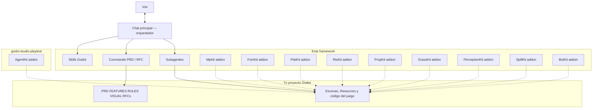
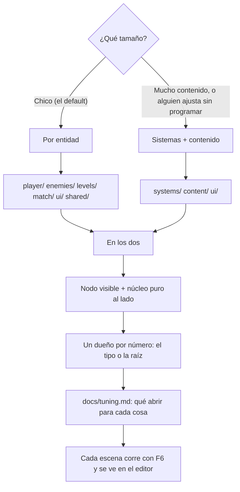
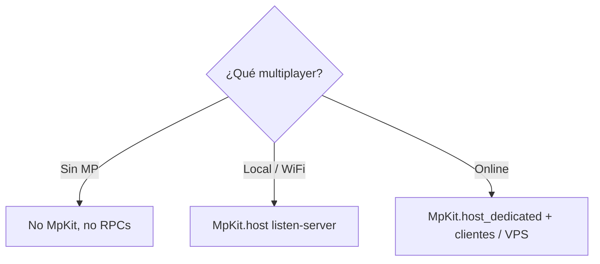
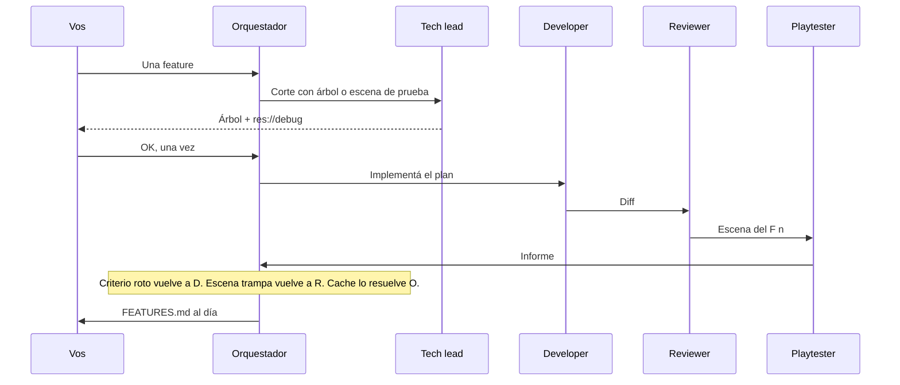

# Arquitectura del kit

Cómo orquesta el chat, cómo se arma un juego Godot y cómo es el flujo de una iteración. El [README](../README.md) tiene el qué y el cómo instalar. Diagrama interactivo: [docs/diagram/](diagram/README.md).

## Arquitectura del orquestador

El chat principal habla con vos. No implementa el título solo. Carga skills Godot, corre commands de producto, e invoca **un rol a la vez**.

Roles (tool de subagentes — `Agent` en Claude Code, `Task` en Cursor — → `subagent_type`):

| Rol | Subagente | Cuándo |
|-----|-----------|--------|
| Tech lead | `studio-tech-lead` | Plan de **un** RFC **con árbol**, sin código |
| Developer | `studio-developer` | Implementa ese plan |
| Reviewer | `studio-reviewer` | Después del código (un pase) |
| Tester | `studio-tester` | Solo si pedís tests o RULES los exige |
| Playtester | `studio-playtester` | Después del review, juega la escena del `F<n>`. Módulo [playtest](https://github.com/Joelnicolass/godot-studio-playtest). Si no está instalado: checklist manual o se saltea |
| Visual | `studio-visual` | Solo si pedís pase UI; hace falta `VISUAL.md` o refs |

Los subagentes **no** ven este chat. El prompt les pasa repo, RFC, tamaño del proyecto, y que lean los artefactos.

## Arquitectura del juego (se pregunta el tamaño)

Hay **un estilo** con **dos tamaños**. El juego se arma igual que un kit: cada sistema es un nodo que se ve en el editor, con sus `@export` y sus señales, y al lado un núcleo puro opcional (`RefCounted`) para las reglas que merecen un test. El agente pregunta el tamaño y recomienda el default.

| Tamaño | Cuándo | Forma |
|--------|--------|-------|
| **Por entidad** (default) | Uno o dos programadores, hasta unos 10 tipos de entidad | Una carpeta por tema en la raíz, con su escena, script, `.tres` y arte; lo común en `shared/` |
| **Sistemas + contenido** | Mucho contenido, alguien que ajusta valores sin programar, o sistemas que se reusan | Reglas en `systems/`, todo lo que editan diseño y arte en `content/`, `ui/` aparte. `content` usa `systems`, nunca al revés |

Clean en capas (`features → core → domain`) ya no se ofrece a un proyecto nuevo: queda para los repos que ya lo declaran o si lo pedís por nombre.

En los dos tamaños:

- **Un dueño por número.** Los números de diseño de una entidad están en el `.tres` de su tipo o en la raíz de su escena, nunca en dos lugares.
- **`docs/tuning.md`** dice, para cada cosa que se puede ajustar, qué archivo, qué nodo y qué propiedad.
- **El nombre dice el tipo:** `bat_type.tres`, `stone_material.tres`, `forest_env.tres`.
- **Lo que se ve al correr se ve en el editor**, y cada `@export` tiene tooltip, rango y unidad.
- Autoloads en `autoloads/`, solo para servicios globales (MpKit **si hay MP**, el bus `Events` solo con señales). Escenas de prueba en `debug/`, fuera del export.

Los árboles completos: skill `godot-layered-architecture` (`by-entity.md`, `systems-content.md`). Las reglas de datos, carpetas y sufijos: skill `godot-code-quality` §0 y §1.

## Multiplayer (siempre se pregunta)

No copies `addons/mp_kit` “por las dudas”. Preguntá el tipo **antes** de RPCs o del addon.

| Tipo | MpKit |
|------|--------|
| **Sin multiplayer** | No se instala |
| **Local / WiFi** | `host()` — el proceso host es un jugador |
| **Online** (internet / VPS) | `host_dedicated()` — mismo proyecto, peer 1 no es jugador. Desarrollá dedicated + clientes; la VPS es el mismo binario |

Tests: skill `godot-testing` (GUT / GdUnit4 y el workflow de CI) **solo** si los pedís. El formato y el lint estándar (`gdformat`, `gdlint`, avisos `UNSAFE_*`) están en `godot-code-quality`.

## Flujo general de desarrollo

De la idea a una base **jugable**. **Iterar gana a un PRD con todo definido.** El camino corto es `/implement-feature`. PRD/RFC siguen siendo opcionales.

Un corte chico (un componente, un `@export`, sin escena de prueba que pueda hacer trampa) no pasa por el tech lead: el árbol lo arma el orquestador, y igual se muestra y se espera el OK.

La escena de prueba no la inventa quien juega. El tech lead la nombra en el árbol (`res://debug/…`, piezas del producto, estado inicial, acción del InputMap). El developer la construye. El reviewer mira que el resultado del criterio no esté ya puesto en el `.tscn`. El playtester solo corre esa escena con input mapeado. Un `.tres` de debug (otros números, mismo script) evita recorrer todo el juego hasta el criterio; un script paralelo o un `call()` que deja el objetivo ya resuelto no lo prueba.

En un chat nuevo, con el kit instalado, pedí el juego o **una feature**. El orquestador corre `/implement-feature` **sin** exigir un GDD completo. Playtest y visual: el orquestador **pregunta**. Tester GUT solo si los pedís. Un RFC grande: `/implement-rfc`. Alcance a mitad de un RFC: `/manage-changes`. Dónde estamos: `/workflow-status`.

Listo cuando: el proyecto parsea headless, `gdformat` / `gdlint` (si el proyecto los usa) quedan en verde, el slice se juega, cada criterio tiene evidencia del review, y `FEATURES.md` + memoria quedan al día (checklist completo en la skill `godot-studio-workflow`).

Diagrama interactivo de este flujo y de cómo entra un kit a tu juego: [docs/diagram/](diagram/README.md).

## Los kits en tu juego

Cada kit es un addon que se copia al juego con `./install.sh --addon <proyecto> <kit>`, sin depender de otro kit. El orquestador lo ofrece cuando la feature lo pide, con su command, y el árbol incluye la carpeta del addon (`[+] addons/<kit>/`).

| Si el juego necesita | Kit | Command | Empezá por |
|---|---|---|---|
| Multijugador (LAN, dedicado, online) | MpKit | `/new-mp-feature` (y *Setup game* en el editor) | `addons/mp_kit/examples/minimal_2d/boot.tscn` |
| Estados de un actor (Idle, Move, Hurt) | FsmKit | `/add-state-machine` | `addons/fsm_kit/examples/minimal_2d/` |
| Saltos de plataformas 2D con perdón | PlatKit | `/add-platformer-2d` | `addons/plat_kit/examples/minimal_2d/` |
| Selección y órdenes de un RTS | RtsKit | `/add-rts-controls` | `addons/rts_kit/examples/minimal_2d/` |
| Props plantados y su navmesh | PropKit | `/add-props` | `addons/prop_kit/examples/minimal_3d/` |
| Pasto 3D | GrassKit | `/add-grass` | `addons/grass_kit/examples/minimal_3d/` |
| Enemigos o guardias que ven y oyen | PerceptionKit | `/add-perception` | `addons/perception_kit/examples/minimal_3d/` |
| Sangre, manchas y charcos (o aceite, baba, tinta) | SpillKit | `/add-spill` | `addons/spill_kit/examples/minimal_3d/` |
| Bots que juegan como una persona (shooter, arena) | BotKit | `/add-bots` | `addons/bot_kit/examples/minimal_3d/` |
| Tableros de hexágonos o de cuadrados, niebla de guerra | GridKit | `/add-grid` | `addons/grid_kit/examples/minimal_3d/` |
| Turnos, fases, rondas y tiempo por turno | TurnKit | `/add-turns` | `addons/turn_kit/examples/minimal/` |
| Recursos y monedas (topes, costos, sustitutos) | WalletKit | `/add-wallet` | `addons/wallet_kit/examples/minimal/` |
| Jugadas validadas con deshacer y repetición | CommandKit | `/add-commands` | `addons/command_kit/examples/minimal/` |
| Árboles de tecnología, talentos o habilidades | UnlockKit | `/add-unlocks` | `addons/unlock_kit/examples/minimal/` |
| Estadísticas con bonus (equipo, buffs, tecnologías) | StatKit | `/add-stats` | `addons/stat_kit/examples/minimal/` |
| Mazo, mano y descarte (robar, mezclar con semilla, rellenar) | DeckKit | `/add-deck` | `addons/deck_kit/examples/minimal/` |
| Dados (tirar, sumar, contar símbolos, semilla) | DiceKit | `/add-dice` | `addons/dice_kit/examples/minimal/` |
| Gestos táctiles (swipe, doble toque, mantener, pellizcar, girar) | GestureKit | `/add-gestures` | `addons/gesture_kit/examples/minimal/` |

El ejemplo mínimo es la integración más chica que anda; el README de cada kit explica su código y suma tips y recomendaciones. Lo que el kit no hace (las reglas, el puntaje, el movimiento de una unidad de RTS) queda en el juego.

## Prioridades (siempre)

- Simple y predecible: cambiar un número abre como mucho 2 archivos.
- Un humano lo encuentra: `docs/tuning.md` dice qué abrir para cada cosa.
- Composición antes que herencia.
- Nodos y editor antes que código.
- Componentes reusables.

## Shaders, sprites 2D y 3D

No inventar FX ni arte de memoria.

- Shaders: [Godot Shaders](https://godotshaders.com/shader/?orderby=date&order=DESC) primero; [Shadertoy](https://www.shadertoy.com) si hay que portar. Un pass = una packed scene.
- Sprites 2D: **preguntá** si querés MCP Aseprite / crear sprites, y pedí **referencias**. Animación: skill `godot-animation`. Feel jugoso: `/add-juicy` + skill `godot-juicy`. Sin OK: placeholder.
- **3D**: **preguntá** si querés el MCP de [Blender](https://www.blender.org/lab/mcp-server/). Si sí: instalalo (Blender 5.1 + add-on Lab + server en Claude Code o Cursor), pedí referencias, y el modelo entra como `.blend` directo o como `.glb`. Sin OK: placeholder. Detalle: `skills/godot-composition-first/assets.md`.
- Materiales / texturas procedurales: **preguntá** si querés crearlos con [Material Maker](https://github.com/RodZill4/material-maker) (`.ptex` → PNG + `.tres`). Skill `godot-material-maker`, `/create-material`. Sin OK: placeholder.
- Mecánica “como en X”: el orquestador la **investiga**, en la web (su wiki, devlogs y charlas, código fuente, frame data, video de gameplay) y, si el juego se puede abrir, decompilándolo, y **deduce** cómo funciona. El informe va al `F<n>` y sigue `/implement-feature`. Skill `godot-feature-research`, `/research-feature`.
